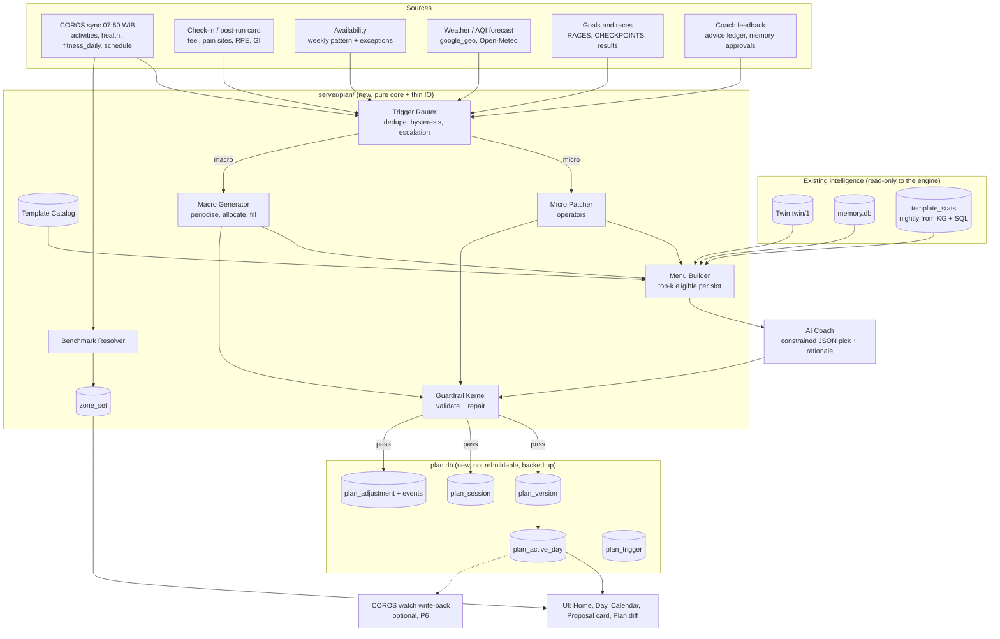
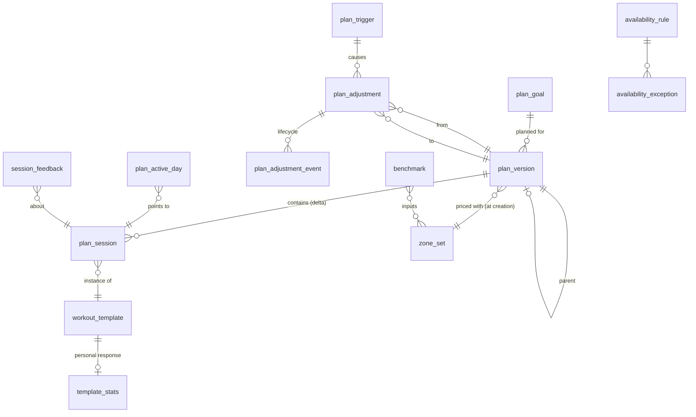

# Lumpad Adaptive Plan Engine: Blueprint, Requirements and Phased Rollout (v2.0)

| | |
|---|---|
| **Version** | **2.0**, 23 Nov 2026. Extends v1.0 (`docs/adaptive-plan-engine-blueprint.md`, kept unchanged) with scope, business and functional requirements, assumptions, constraints and dependencies, NFRs, acceptance criteria and sign-off, and an expanded risk register. The architecture, schema and rollout are the same as v1.0 |
| **Date** | 23 Nov 2026 |
| **Implementation** | **P0 implemented 23 Nov 2026** in `server/plan/` (not committed, not deployed, `plan.db` not yet created on the server). Evidence: `node --test server/plan/plan.test.js` (9 tests) and full `npm test` (444 pass, 0 fail). Deviations from §10.3 made during build: `plan_adjustment.from_version` is nullable and `loop` allows `'import'` (the import has no parent); `plan_session` also blocks DELETE; `plan_adjustment_event.by` is CHECK-constrained. Measured on version 1: plan-only load guard breached in **29 of 54** judged weeks, plus 6 long-run (R-LR-110) breaches; seeded with the twin actuals (15.9 km/wk, longest 36.9 km) 32 of 58 weeks, and W-5 is 35.5 km against a 17.5 km cap |
| **Implementation (update)** | P0–P3 built; **P4 built 23 Nov 2026** (macro generator, goals, availability, Plan v2 proposal), dormant. New decisions raised by the build: DEC-8 (race km exempt from the weekly guard), DEC-9 (guard baseline = previous 4 build weeks), DEC-10 (cutback ratio and peak cap). FR-MAC-2 originally asked for a cutback every 3rd or 4th week at −20 to −30 %: under the literal load guard that yields no growth, so the default is ×0.9 every 4th week. See `docs/plan-engine-signoff/p4.md` for the projection table (peak 20.9–34.9 km/week depending on interpretation, against 96 in the imported plan) |
| **Implementation (update 2)** | **P5 and the screens built 23 Nov 2026**, dormant: AI selector (`PLAN_COACH=1` to enable; off by default; no real model call has been made), template statistics, ranking, `plan_why`, and the Plan engine screens. Evidence and the list of what is not done: `docs/plan-engine-signoff/p5.md`, `docs/plan-engine-signoff/ui.md` |
| **Status** | **PROPOSAL, awaiting sign-off G-BP (§12.3).** Nothing is built. No production code, data or migration was changed while writing this. Items marked **[DECIDE]** need the athlete's answer before the phase that uses them |
| **Code baseline** | branch `coach-provider-settings` at `ed06a02` |
| **Discovery mode** | Read-only. Code reading, SQLite `*.snapshot.db` opened with `immutable=1`, `kv.json` keys and shapes only, `free`/`df`. Postgres and Neo4j were not queried |
| **Goal** | Replace the static season file (`src/data/plan.json`) with a versioned plan that a deterministic engine keeps safe and the AI Coach personalises. It runs two loops: daily/weekly **micro-patches** and block-level **macro-regeneration** |

---

## 1. Executive summary

**Today the plan is a build artefact, not data.** `tools/build_season.mjs` turns a COROS "plan A" text snapshot plus `src/lib/season.js` rules into a 404-day `src/data/plan.json` (23 Nov 2026 → 31 Dec 2027). Nine Node modules and the Go binary (through `go:embed`) import that file directly. Adaptation happens in three places that do not share code or storage:

1. `src/lib/scaler.js`: a 72 h gate downgrade, stored in kv `lumpad.scale`, client-side.
2. `src/lib/missed.js`: missed-run scenarios, stored in kv `lumpad.missed.<date>`. It gives advice only and never edits the plan.
3. `lumpadd/internal/decision/replan.go`: six Phase-5 rules. They are unit-tested and write to Postgres `coach.decision` and `plan.overlay`, but they are not live.

**The static plan breaks the athlete's own locked load guard.**

| Check (measured 23 Nov 2026) | Value |
|---|---|
| Actual weekly running km, last 4 weeks (twin, after Borobudur) | **15.9 km** |
| Plan week W-4 (starts 30 Nov) | **60.5 km**, 3.8× the 4-week average |
| Plan weeks over +10 % of the plan's own previous-4-week average | **29 of 54** |
| Plan peak week | 96 km (W9, W18, …) vs a 2026 actual average of ~31 km/wk |
| Benchmarks hard-coded in the plan path | VDOT 31.7 (`plan.js` TARGET), threshold pace 356 s/km (`athlete.js`). COROS now reports **355** s/km (`fitness_daily`, 23 Nov) |

Every day, the gate and missed-run rules patch around a plan that was unsafe from the start. That is the core problem this engine solves.

**Proposed architecture (hybrid, three layers, one store):**

```
           ┌──────────────── Deterministic core (pure JS, ms, no LLM) ────────────────┐
benchmarks → Benchmark Resolver → zone_set (versioned)                                │
twin/load  → Guardrail Kernel  (locked rules → executable constraints, validate+repair)│
templates  → Template Catalog  (KB 02.2 + COROS codes + Lumpad builders, symbolic zones)│
           │  Macro Generator (periodise → allocate → fill)   Micro Patcher (operators)  │
           └───────────────┬───────────────────────────────────────┬──────────────────┘
                           │ eligible menu (top-k per slot)        │ patch + rationale template
                           v                                       v
                 AI Coach (DeepSeek Flash / Claude): picks from the menu, writes the rationale.
                 Constrained JSON only, re-validated. Fallback = deterministic top pick.
                           │
                           v
            plan.db: plan_version (delta chain) · plan_session · plan_active_day (materialised)
                     plan_trigger · plan_adjustment (audit, append-only) · plan_adjustment_event
```

- **The deterministic layer owns every number**: zones, doses, weekly km, long-run caps, spacing. It also owns the final say: every candidate, whether generated, patched or LLM-picked, passes `validate()` before it can become a version.
- **The AI Coach owns choice and words**: which eligible template fills a slot, given memory, the twin, the KG's history of each template, and live context. It also writes the explanation. It never emits a free number. It picks an option id and a dose inside a range the kernel gave it.
- **Sessions store symbolic intensities** (`Z2`, `T`, `M`, `TT@line`), resolved against the current `zone_set` when read. A new threshold pace or LTHR **re-prices the whole plan with no regeneration and no LLM call**.
- **Lightweight by design**: no new process, no new dependency, no embeddings. Generating 48 weeks takes ≈ 10–50 ms in the API process at < 10 MB. The LLM is used about once per macro regeneration (≤ 14k tokens) and **zero times for routine micro-patches**, whose rationale rides along in the daily brief the system already pays for.

**Day one changes nothing visible.** Version 1 is a byte-identical import of `plan.json`, so G3 (shadow parity) and every screen stay unchanged until each consumer is cut over behind a golden test.

### 1.1 Document map

| Part | Sections |
|---|---|
| Requirements | §2 Scope · §3 Business requirements · §4 Functional requirements · §5 Assumptions, constraints, dependencies · §6 Non-functional requirements |
| Design | §7 Discovery findings · §8 Design principles · §9 Architecture · §10 Data model |
| Delivery | §11 Phased rollout · §12 Acceptance criteria and sign-off · §13 Risks and mitigation · §14 Decisions · §15 Files · Appendix A Traceability |

Ids used throughout: `BR-n` business requirement, `FR-<area>-n` functional, `NFR-<cat>-n` non-functional, `A-n` assumption, `C-n` constraint, `DEP-n` dependency, `AC-<phase>-n` acceptance criterion, `R-n` risk, `DEC-n` decision, `S-n` / `O-n` in / out of scope.

---

## 2. Scope

### 2.1 In scope

| # | Item | Phase | Reference |
|---|---|---|---|
| S-1 | New plan store `plan.db`: versioned plan (`plan_version`, `plan_session`, `plan_active_day`), triggers, append-only adjustment audit, feedback, goals, availability, benchmarks, zone sets, template catalog | P0 | §10 |
| S-2 | One-time import of `src/data/plan.json` as version 1, byte-identical, with the original day kept in `legacy` | P0 | §10.4 |
| S-3 | Benchmark Resolver and versioned zone sets (threshold pace, VDOT, LTHR / HR ends, HRmax flag, durability, heat cost) with provenance | P0 (shadow) → P2 (live) | §9.2.1 |
| S-4 | Guardrail Kernel: the 10 locked rules plus the `replan.go` rules compiled into ~18 executable constraints with ids, `validate()` and `repair()` | P0 (report) → P3 (enforcing) | §9.2.2 |
| S-5 | Workout Template Catalog seeded from COROS plan-A courses, KB `02.2` structure, KB `02.3` strength and Lumpad builders; symbolic intensities | P0 | §9.2.3 |
| S-6 | Read-path cutover: `/api/plan/*` routes; the 9 Node readers of `plan.json`, `src/lib/calendar.js` and the UI screens; the Go embed replaced by the Postgres mirror | P1 | §10.5 |
| S-7 | Render-time zone resolution (symbolic → HR/pace, heat-adjusted through the existing `prescription.js`) | P2 | §9.2 |
| S-8 | Trigger Router (12 trigger types, dedupe, hysteresis, escalation, anti-thrash) | P3 | §9.3.1 |
| S-9 | Micro-patch operators replacing `scaler.js` and `missed.js` behaviour and `replan.go` rules 1, 4, 5; daily workout menu (A/B/C) | P3 | §9.3.2 |
| S-10 | Proposal, approval, reject, revert and audit screens; availability and goal editors; plan diff view | P3–P4 | §10.5 |
| S-11 | Macro generator (periodise → allocate → fill), escalation from micro, frozen horizon; the "Plan v2" proposal | P4 | §9.3.3 |
| S-12 | AI Coach as constrained selector (`plan_macro`) and explainer (`plan_why`); patch summary inside the existing daily brief; grounding of numbers | P5 | §9.5 |
| S-13 | Personalisation inputs: `template_stats` (nightly), twin, memory (≥ MEASURED), validated correlation edges; `:WorkoutTemplate` projection in the KG | P5 | §9.4 |
| S-14 | Outcome evaluation of adjustments 3–14 days later and staged memory write-back (candidate + HYPOTHESIS) | P5 | §9.4 |
| S-15 | Postgres mirror migration `0008_plan_engine.sql` and shadow-mirror registration | P0–P1 | §10.1 |
| S-16 | Tests (golden, property, parity, replay eval, LLM contract), status endpoint, backup inclusion, rollback flag | all | §11 |
| S-17 | Migration and retirement of kv `lumpad.scale` and `lumpad.missed.<date>` | P3 | §10.1 |

**Conditional scope** (built only if the linked decision says yes):

| # | Item | Phase | Decision |
|---|---|---|---|
| S-C1 | COROS watch write-back of approved sessions (≤ 14 days ahead) | P6 | DEC-3 |
| S-C2 | Auto-apply of safety-direction patches | P3 | DEC-1 |
| S-C3 | Strength scheduling inside the engine (Upper / Lower / Full) | P4 | DEC-7 |
| S-C4 | Go port of kernel, operators and generator | P7 | redesign Phase 5 roadmap |

### 2.2 Out of scope

| # | Item | Why / where it lives instead |
|---|---|---|
| O-1 | Changing any existing calculation: VDOT, zone math, PMC/ACWR, readiness, FIT parsing, twin metrics | The engine consumes them. Changing them resets G3 and the G1/G2 parity |
| O-2 | Multi-athlete or multi-tenant support | Single-athlete system by design |
| O-3 | Medical diagnosis, injury treatment protocols, clearing the athlete to train | Red-flag rule: refer to a clinician. Only a generic return-to-run template is in scope |
| O-4 | New nutrition or fueling logic | The existing `prescription.js` fueling block is reused unchanged |
| O-5 | Authoring new strength-programme content | KB `02.3` is used as is; only scheduling is in scope (S-C3) |
| O-6 | Calendar OAuth import (Google Calendar or ICS) | Later, read-only exception source (DEC-4) |
| O-7 | Text embeddings, vector search, new ML models, LLM fine-tuning | Not needed for a ≤ 50-template catalog; protects the RAM budget |
| O-8 | Real-time in-run guidance or watch apps | Watch shows pushed workouts only (S-C1) |
| O-9 | Merging Garmin-era device scores (VO2max, load, race predictions) into benchmarks | Per the 23 Nov decision, device scores stay separate; FIT-derived series are combined |
| O-10 | Closing audit findings C1 (public site), C2 (public write paths), C3 (off-site backup) | Separate work; they are **dependencies** (DEP-2, DEP-3) |
| O-11 | UI redesign beyond the screens listed in S-10 | Home redesign (`ed06a02`) stays; new cards follow its namespace |
| O-12 | Writing to Strava or any third-party service except COROS (S-C1) | Strava is read-only by agreement |
| O-13 | Race registration, travel, results import | Results stay athlete input in kv `lumpad.results` |
| O-14 | Server hardware changes or Postgres-native production storage | DEC-6: SQLite now |

### 2.3 Scope boundary rules

- The engine **may** decide: which template, which day, which dose inside a template's range, whether to downgrade or move, and the block structure.
- The engine **may not** decide: race goals, race classes, locked-rule thresholds, benchmark overrides set by the athlete, or anything on a past day.
- The AI Coach **may** pick among options the kernel produced and write text. It **may not** introduce a template, a number or a date that the kernel did not offer.

---

## 3. Business requirements

| Id | Requirement | Success measure | Priority |
|---|---|---|---|
| BR-1 | **Safety first.** The plan never prescribes training that breaks a locked rule or ignores a red flag | 0 kernel violations in any active version; 100 % of red-flag days show rest plus referral | Must |
| BR-2 | **Goal alignment.** The plan serves the race calendar (JRF FM A-race 24 Oct 2027 sub-4:00; Jakim B; MJM D; Bormar C) and changes when a goal, a checkpoint result or the kill gate changes | Every active version has a goal; a goal change produces a macro proposal within one engine cycle | Must |
| BR-3 | **Personalisation.** Workout choice uses this athlete's measured history and feedback before generic doctrine | From P5, ≥ 70 % of quality and long-run slots chosen with `personal_response` n ≥ 3; templates rated "too hard" twice are de-prioritised | Should |
| BR-4 | **Same-day responsiveness.** The plan reacts on the day to readiness, pain, missed sessions, schedule conflicts, heat and air quality | Proposal available ≤ 5 min after the input reaches the server | Must |
| BR-5 | **Transparency and control.** Every change is explained, traceable and reversible; load increases need the athlete's consent | 100 % of changes have an audit row and a rationale; 100 % of load-increasing changes approved by the athlete | Must |
| BR-6 | **Low running cost.** It runs on the existing 2 GB VPS and inside the LLM monthly cap | NFR-RES and NFR-COST targets met for 30 consecutive days | Must |
| BR-7 | **No disruption.** The current app, the G3 migration, the morning sync and the race freezes are unaffected | No change to existing endpoint outputs before P1 sign-off; no cutover inside a freeze | Must |
| BR-8 | **One source of truth.** UI, coach, twin, features, forecast and Go read the same plan | 0 remaining imports of `plan.json` outside the import tool after P1 | Must |
| BR-9 | **Learn from outcomes.** The system records whether each change helped | ≥ 80 % of applied adjustments older than 14 days carry an outcome verdict | Should |

---

## 4. Functional requirements

Priority uses MoSCoW. "Phase" is the phase in which the requirement must pass its acceptance criteria (§12).

### 4.1 Plan store and versioning (FR-PLN)

| Id | Requirement | BR | Pri | Phase |
|---|---|---|---|---|
| FR-PLN-1 | The system stores the plan as versions; exactly one version is active at any time | BR-5, BR-8 | Must | P0 |
| FR-PLN-2 | A version stores only the sessions it sets or clears (delta), with a parent and a base macro version | BR-6 | Must | P0 |
| FR-PLN-3 | Session rows and adjustment rows can never be updated or deleted (DB-enforced) | BR-5 | Must | P0 |
| FR-PLN-4 | Activation is atomic: old version superseded, new version active, `plan_active_day` rebuilt, audit row written, in one transaction, with an optimistic `expected_parent` check | BR-5 | Must | P0 |
| FR-PLN-5 | Days before today (WIB) cannot be changed by any engine version; manual corrections are allowed and audited | BR-1, BR-5 | Must | P0 |
| FR-PLN-6 | The same inputs (`inputs_hash`) never create a second version | BR-6 | Must | P0 |
| FR-PLN-7 | Any adjustment can be reverted; a revert is itself a new version | BR-5 | Must | P3 |
| FR-PLN-8 | `plan.json` is imported once as version 1 and renders identically to today | BR-7 | Must | P0 |

### 4.2 Benchmarks and zones (FR-BEN)

| Id | Requirement | BR | Pri | Phase |
|---|---|---|---|---|
| FR-BEN-1 | The resolver picks each benchmark by the precedence in §9.2.1 and records source, evidence tag and date | BR-3 | Must | P0 |
| FR-BEN-2 | A benchmark change creates a new immutable `zone_set`; only one zone set is active | BR-8 | Must | P0 |
| FR-BEN-3 | Changes need hysteresis (sustained 3 days, or a TT result) before a new zone set activates | BR-1 | Must | P2 |
| FR-BEN-4 | A zone-set change re-renders the plan and creates **no** plan version; it escalates to macro only when ΔVDOT ≥ 1.0, the kill gate fires or the CP11 ratio < 0.85 | BR-2, BR-6 | Must | P2 |
| FR-BEN-5 | An athlete override in Profile › Zones always wins and is shown as such | BR-5 | Must | P2 |
| FR-BEN-6 | TT results run in heat or with a DNF or black flag are not accepted as VDOT points without the athlete's confirmation | BR-1 | Should | P2 |

### 4.3 Guardrail Kernel (FR-GRD)

| Id | Requirement | BR | Pri | Phase |
|---|---|---|---|---|
| FR-GRD-1 | Every candidate (generated, patched, LLM-picked, manual) passes `validate()` before it can become a version | BR-1 | Must | P0 |
| FR-GRD-2 | Each constraint has a stable id, a severity (`repair` / `block`), the memory rule it implements, and a deterministic repair | BR-1, BR-5 | Must | P0 |
| FR-GRD-3 | Repairs never increase load (km, intensity minutes or hard-session count) | BR-1 | Must | P0 |
| FR-GRD-4 | Race, checkpoint and gate days are immutable to micro operators | BR-2 | Must | P0 |
| FR-GRD-5 | A red flag (`R-REDFLAG`) blocks training output for the day and shows the referral text from `safety.js` | BR-1 | Must | P3 |
| FR-GRD-6 | The kernel runs nightly over the active version and reports any violation caused by new data (for example a lower 4-week average) as a `drift` trigger | BR-1 | Must | P3 |
| FR-GRD-7 | The kernel produces a readable report (rule id, pass/repaired/block, numbers used) stored in the adjustment row | BR-5 | Must | P0 |

### 4.4 Template Catalog (FR-TPL)

| Id | Requirement | BR | Pri | Phase |
|---|---|---|---|---|
| FR-TPL-1 | Templates are versioned and carry kind, purpose, phases, dose ranges, symbolic steps, requirements, contraindications, variants, a progression variable, cues and source pointers | BR-3 | Must | P0 |
| FR-TPL-2 | All 7 COROS plan-A courses and all Lumpad builders exist as templates that reproduce today's steps exactly | BR-7 | Must | P0 |
| FR-TPL-3 | The double-threshold day is excluded (KB 03.6 rejection) | BR-1 | Must | P0 |
| FR-TPL-4 | `eligible(slot, ctx)` filters by phase, requirements, injury sites, Ramadan, weather/AQI and available minutes | BR-1, BR-4 | Must | P3 |
| FR-TPL-5 | Every template with a quality or long purpose has a heat and an easier variant | BR-4 | Should | P3 |
| FR-TPL-6 | A change in a template's KB source section is flagged for review | BR-5 | Could | P5 |

### 4.5 Triggers (FR-TRG)

| Id | Requirement | BR | Pri | Phase |
|---|---|---|---|---|
| FR-TRG-1 | The router accepts the 12 trigger types in §9.3.1 and stores each with its measured payload | BR-4, BR-5 | Must | P3 |
| FR-TRG-2 | Triggers are deduplicated by key; a repeated input on the same day does not create a second proposal | BR-6 | Must | P3 |
| FR-TRG-3 | Each trigger is routed to `micro`, `macro`, `render` or `none`; the route and the reason are stored | BR-5 | Must | P3 |
| FR-TRG-4 | Escalation rules (§9.3.1) raise a macro trigger from repeated micro triggers | BR-2 | Must | P4 |
| FR-TRG-5 | Anti-thrash: frozen horizon today + 2 days for macro; ≤ 1 macro proposal per 7 days except goal or injury triggers; open proposals expire at the end of their first day | BR-5 | Must | P4 |
| FR-TRG-6 | Triggers are evaluated after the morning sync, after each check-in, at the 11:00 and 20:00 WIB missed checks, after a forecast pull and nightly at 02:30 WIB | BR-4 | Must | P3 |

### 4.6 Micro-patching and daily menu (FR-MIC, FR-MNU)

| Id | Requirement | BR | Pri | Phase |
|---|---|---|---|---|
| FR-MIC-1 | The 10 operators in §9.3.2 exist; a patch touches ≤ 10 days | BR-4 | Must | P3 |
| FR-MIC-2 | Each patch carries a deterministic rationale whose numbers all come from the diff | BR-5 | Must | P3 |
| FR-MIC-3 | The missed-session behaviour of `missed.js` (3 scenarios, all checks, recommendation order, evening cut-off 20:00 / 19:00 for hard) is reproduced | BR-7 | Must | P3 |
| FR-MIC-4 | The 72 h gate downgrade of `scaler.js` is reproduced | BR-7 | Must | P3 |
| FR-MIC-5 | Missed volume is never added to other days | BR-1 | Must | P3 |
| FR-MIC-6 | Safety-direction patches follow DEC-1 (auto-apply with undo, or propose); all other patches are proposals | BR-5 | Must | P3 |
| FR-MNU-1 | For each planned day the system offers 2–3 validated options: A as planned, B safe variant, C time/length alternative | BR-4 | Must | P3 |
| FR-MNU-2 | Choosing an option is one tap and is audited as a `manual` trigger | BR-5 | Must | P3 |

### 4.7 Macro-regeneration (FR-MAC)

| Id | Requirement | BR | Pri | Phase |
|---|---|---|---|---|
| FR-MAC-1 | The generator builds phases backward from each active goal, starting from the **actual** 4-week volume | BR-1, BR-2 | Must | P4 |
| FR-MAC-2 | Weekly ramp ≤ +10 %, a cutback every 3rd or 4th week, ≥ 80 % low-intensity share, taper rules, Ramadan rules, availability windows and preferred days are respected | BR-1 | Must | P4 |
| FR-MAC-3 | Key sessions are placed in priority order (race/CP → long → quality 1 → quality 2 → Lower → Upper → easy) | BR-2 | Must | P4 |
| FR-MAC-4 | Regeneration never changes past days or the frozen horizon | BR-5 | Must | P4 |
| FR-MAC-5 | Every macro version is a proposal; the athlete sees a diff (weekly km curve, moved or added key sessions) and accepts or rejects | BR-5 | Must | P4 |
| FR-MAC-6 | The generator works with no LLM (engine-only proposals) | BR-6 | Must | P4 |
| FR-MAC-7 | During freeze windows and tapers, macro proposals are held | BR-7 | Must | P4 |

### 4.8 AI Coach integration (FR-AIC)

| Id | Requirement | BR | Pri | Phase |
|---|---|---|---|---|
| FR-AIC-1 | The `plan_macro` intent receives a skeleton and ≤ 3 options per slot and returns JSON picks (option id, dose inside range, ≤ 1-line reason) plus a ≤ 120-word summary | BR-3 | Should | P5 |
| FR-AIC-2 | Invalid, out-of-range or missing picks fall back to the deterministic default, slot by slot | BR-1 | Must | P5 |
| FR-AIC-3 | Numbers in coach text must appear in the diff or zone set; otherwise the deterministic rationale is shown | BR-5 | Must | P5 |
| FR-AIC-4 | `plan_why` explains one adjustment on request | BR-5 | Could | P5 |
| FR-AIC-5 | The daily brief includes today's open and applied adjustments; no separate call is made for micro patches | BR-6 | Should | P5 |
| FR-AIC-6 | All calls go through the existing guard, cap, `coach_run` ledger and `req_hash` reuse | BR-6 | Must | P5 |

### 4.9 Inputs: goals, availability, feedback (FR-INP)

| Id | Requirement | BR | Pri | Phase |
|---|---|---|---|---|
| FR-INP-1 | Goals are seeded from `RACES` and `CHECKPOINTS` and are editable (date, class, target, parameters such as `peak_cap_km`) | BR-2 | Must | P4 |
| FR-INP-2 | A weekly availability pattern (windows, max minutes, preferred day roles) and dated exceptions are editable on mobile | BR-4 | Must | P4 |
| FR-INP-3 | After a session the athlete can record RPE (1–10), a verdict (too easy / right / too hard) and a note in ≤ 2 taps | BR-3, BR-9 | Should | P3 |
| FR-INP-4 | Goal or availability edits raise the matching trigger | BR-2 | Must | P4 |
| FR-INP-5 | Goal rows are validated (no duplicate dates, a valid class, a date in the future) so a calendar edit cannot break jobs (audit H7 precedent) | BR-7 | Must | P4 |

### 4.10 Audit, approval and outcomes (FR-AUD)

| Id | Requirement | BR | Pri | Phase |
|---|---|---|---|---|
| FR-AUD-1 | Every activation writes a `plan_adjustment` row: trigger, from/to version, scope, operators, per-date diff, weekly km before/after, kernel report, input snapshot, both rationales, LLM run id and tokens, auto flag, expected checks | BR-5 | Must | P0 |
| FR-AUD-2 | Lifecycle events (proposed, applied, rejected, expired, reverted, evaluated) are recorded with the actor (`athlete`, `engine`, `system`) | BR-5 | Must | P3 |
| FR-AUD-3 | An athlete-facing "Plan changes" list shows the log with filters by date and trigger type | BR-5 | Should | P3 |
| FR-AUD-4 | 3–14 days after an applied adjustment, an outcome verdict (helped / neutral / harmed / unknown) is computed with the `ledger.go` semantics | BR-9 | Should | P5 |
| FR-AUD-5 | An outcome may propose a memory (candidate + HYPOTHESIS) through `applyWriteback`; nothing is promoted automatically | BR-9, BR-1 | Could | P5 |

### 4.11 Knowledge Graph and memory (FR-KG)

| Id | Requirement | BR | Pri | Phase |
|---|---|---|---|---|
| FR-KG-1 | `template_stats` is refreshed nightly from SQLite (plan session ↔ matched activity ↔ FIT metrics ↔ pain in the next 48 h) | BR-3 | Should | P5 |
| FR-KG-2 | graph-sync projects `:WorkoutTemplate` nodes and `ATTEMPT_OF` edges; PlanDay nodes come from `active_day` | BR-3 | Could | P5 |
| FR-KG-3 | Memory signals enter scoring only at evidence ≥ MEASURED; HYPOTHESIS appears in rationale only | BR-1, BR-3 | Must | P5 |
| FR-KG-4 | No runtime path waits on Neo4j | BR-6 | Must | P0 |

### 4.12 Integration, migration and watch (FR-API, FR-MIG, FR-WB)

| Id | Requirement | BR | Pri | Phase |
|---|---|---|---|---|
| FR-API-1 | Routes in §10.5 exist; all write routes need the authenticated athlete session or the bearer token | BR-1, BR-5 | Must | P1/P3 |
| FR-API-2 | `GET /api/plan/range` returns sessions resolved against the active zone set | BR-8 | Must | P1 |
| FR-MIG-1 | The 9 server readers, `calendar.js` and the UI read through the plan API or store; the Go embed is replaced by the mirror | BR-8 | Must | P1 |
| FR-MIG-2 | `PLAN_SOURCE=json|engine` switches every reader back to `plan.json` | BR-7 | Must | P1 |
| FR-MIG-3 | Existing kv `lumpad.scale` and `lumpad.missed.*` values are migrated as versions and triggers, then the keys are no longer written | BR-8 | Must | P3 |
| FR-MIG-4 | The PWA keeps the last fetched 14 days for offline viewing | BR-7 | Should | P1 |
| FR-WB-1 | (Conditional, DEC-3) Approved sessions ≤ 14 days ahead are pushed to COROS; a dry-run mode logs the calls without sending | BR-8 | Could | P6 |
| FR-WB-2 | (Conditional) One action restores the COROS plan-A schedule | BR-7 | Could | P6 |

### 4.13 Observability (FR-OBS)

| Id | Requirement | BR | Pri | Phase |
|---|---|---|---|---|
| FR-OBS-1 | `GET /api/plan/status` returns active version, zone set, open proposals, last trigger per type, kernel summary and `plan_*` token use this month | BR-5, BR-6 | Must | P1 |
| FR-OBS-2 | The weekly review shows adjustments applied/rejected, outcome verdicts and adherence by template | BR-9 | Should | P5 |
| FR-OBS-3 | Three consecutive kernel blocks raise an ops alert | BR-1 | Should | P3 |

---

## 5. Assumptions, constraints and dependencies

### 5.1 Assumptions

If an assumption turns out to be false, the linked risk (§13) applies.

| Id | Assumption | If false | Risk |
|---|---|---|---|
| A-1 | One athlete uses the system; no other users need plans | Schema needs an athlete key; out of scope | — |
| A-2 | COROS stays the primary device and the 07:50 WIB sync keeps running daily | Benchmarks and triggers go stale; engine falls back to conservative defaults | R-9 |
| A-3 | COROS `fitness_daily.threshold_pace_s_km` stays available (13 rows since 11 Nov) | Threshold pace comes from TTs and seeds only | R-9 |
| A-4 | The athlete completes the 1-tap check-in on most days (≥ 70 %) and logs pain when it occurs | Readiness and pain triggers miss events | R-10 |
| A-5 | The existing `src/lib` and twin calculations are correct (G1/G2 passed) | Engine inherits the error; fix goes through the normal G-gate process | — |
| A-6 | G3 passes about 4–5 Dec 2026 | P1 moves right by the delay | R-5 |
| A-7 | The athlete reviews proposals within about 24 h and macro proposals within about 3 days | Proposals expire; the plan keeps the previous version (safe default) | R-2 |
| A-8 | DeepSeek Flash stays available inside the monthly cap; Claude is optional | Engine-only proposals (FR-MAC-6) | R-13 |
| A-9 | Google Weather and Air Quality APIs are enabled on the key (remaining-work item 4) | Heat/AQI triggers use Open-Meteo weather only, no AQI | R-14 |
| A-10 | KB doc structure (02.2, 02.3, 06.x) remains valid as a source of session structure | Templates need a review (FR-TPL-6) | R-8 |
| A-11 | The server stays at 2 vCPU / ~2 GB RAM as measured on 23 Nov (a 4 GB upgrade is mentioned in `remaining-work.md` but not present) | More headroom; no design change needed | — |
| A-12 | WIB (UTC+7) is the only time zone for planning; race travel to other zones is handled manually | Date-boundary handling must be extended | R-12 |
| A-13 | The athlete accepts that the first macro proposal will have much lower volume than plan.json | Keep the import active and use only micro patches | R-1 |

### 5.2 Constraints

| Id | Constraint | Source |
|---|---|---|
| C-1 | 2 vCPU, 1.96 GB RAM (≈ 1.09 GB available, swap in use), 24 GB free disk | measured 23 Nov |
| C-2 | No new resident process, no new npm or Go dependency, no embedding model | resource budget (§9.6) |
| C-3 | Production writer is Node + SQLite; Go + Postgres is a shadow mirror until the redesign cutover | `remaining-work.md` §6 |
| C-4 | No change to engine calculations during G3 (until G3 passes) | `remaining-work.md` §2 |
| C-5 | No software cutovers 30 May – 20 Jun 2027 and 3 – 24 Oct 2027; old app retires 17 Aug 2027 | `remaining-work.md` §1 |
| C-6 | LLM spend inside `DEEPSEEK_MONTHLY_CAP_CNY` (¥15) and the existing guard; no assumed prices | `plan-intelligence-layer.md` C11, `llm.js` |
| C-7 | Locked rules are owned by the athlete; the engine may implement them but never weaken them | `memory.js` `LOCKED_RULES` |
| C-8 | Privacy: no new personal data leaves the server; weather/AQI by 0.1° cell only; Strava data never sent to an LLM beyond shoe name and mileage | `plan-intelligence-layer.md` §0.3, `google_geo.js` |
| C-9 | COROS write tools accept dates 0–90 days ahead; COROS publishes no quotas, so archive budgets apply | `Profile.jsx` tool table, README |
| C-10 | Google calls under `GOOGLE_DAILY_CAP` (4000/day) | `remaining-work.md` §5 |
| C-11 | Plan writes must not use the public `PUT /api/kv` path | audit C2 |
| C-12 | Memory and graph-sync jobs run as the `lumpad` user (root silently prunes Aura) | memory note `graph-sync-run-as-lumpad` |
| C-13 | Garmin-era device scores are never mixed with COROS device scores | memory note `garmin-history-import` |

### 5.3 Dependencies

| Id | Dependency | Needed by | Owner | Status (23 Nov) |
|---|---|---|---|---|
| DEP-1 | G3 shadow gate passed | P1 | operator | running, earliest ≈ 4 Dec |
| DEP-2 | Audit C1/C2 closed: login enforced, write routes authenticated | P3 (any write route live; auto-apply) | operator | open (login OFF at audit) |
| DEP-3 | Audit C3 closed: off-site encrypted backup with a tested restore, including `plan.db` | P1 (plan.db becomes source of truth) | operator | not installed |
| DEP-4 | COROS sync, `fitness_daily`, FIT import | P0+ | system | active |
| DEP-5 | Twin `twin/1` job and `daily_feat` | P0+ | system | active (47 versions) |
| DEP-6 | Check-in and post-run card (`daily_log`) | P3 | system | active |
| DEP-7 | Google Weather / Air Quality enabled on the key | P3 (heat/AQI triggers) | athlete | partly; listed in remaining-work item 4 |
| DEP-8 | LLM provider config (DeepSeek; optional Claude with env prices) | P5 | athlete | DeepSeek active; Claude pending key |
| DEP-9 | graph-sync to Aura | P5 (FR-KG-2 only) | system | active |
| DEP-10 | KB export in `server/data/kb/Running_project_export` | P0 | athlete | present (36 docs) |
| DEP-11 | COROS write tools reachable through the existing OAuth client | P6 | system | read path verified; write path not used yet |
| DEP-12 | Redesign Phase 5 / 6 schedule | P7 | operator | Phase 5 code written, gates not started |
| DEP-13 | Athlete answers DEC-1 … DEC-7 | per phase (§14) | athlete | open |

---

## 6. Non-functional requirements

| Id | Category | Requirement | Measure / target | Verified by |
|---|---|---|---|---|
| NFR-PERF-1 | Performance | Plan read for 90 days | p95 ≤ 20 ms server time | load test, `/api/plan/status` timings |
| NFR-PERF-2 | Performance | Day view with menu and open proposals | p95 ≤ 50 ms server time | load test |
| NFR-PERF-3 | Performance | Trigger → stored proposal (excluding external fetches) | ≤ 1 s | trigger timestamps |
| NFR-PERF-4 | Performance | Deterministic macro generation, 48 weeks, incl. validation | p95 ≤ 200 ms | benchmark test |
| NFR-PERF-5 | Performance | Macro proposal with LLM | ≤ 120 s end to end, asynchronous; UI never blocks | coach_run timings |
| NFR-RES-1 | Resources | Added API-process memory | steady ≤ 20 MB, peak ≤ 40 MB | RSS before/after, 7 days |
| NFR-RES-2 | Resources | Nightly engine work | ≤ 1 s CPU; never 07:00–09:00 WIB or during a COROS archive session | job ledger |
| NFR-RES-3 | Resources | `plan.db` growth | ≤ 50 MB per year | file size |
| NFR-COST-1 | Cost | `plan_*` LLM tokens | ≤ 200k per month (configurable `PLAN_TOKEN_CAP`); 0 tokens for micro patches | `coach_run.usage` |
| NFR-COST-2 | Cost | Engine Google calls | ≤ 10 per day | Google usage counter |
| NFR-REL-1 | Reliability | Plan reads keep working with the LLM, Aura, Google and COROS all unavailable | 100 % of reads served from SQLite | fault-injection test |
| NFR-REL-2 | Reliability | No partial state after a crash during activation | 0 half-activated versions | kill-during-activation test |
| NFR-REL-3 | Reliability | Engine job failures do not stop other intel jobs | isolated try/catch, job ledger entry | test |
| NFR-REL-4 | Recovery | Plan data recovery | RPO ≤ 24 h off-site; RTO ≤ 2 h with a tested restore | restore test (DEP-3) |
| NFR-SAF-1 | Safety | Kernel violations in any active version | 0 (checked at activation and nightly) | nightly report |
| NFR-SAF-2 | Safety | LLM cannot raise load above what the kernel offered | 0 accepted out-of-range picks | LLM contract tests |
| NFR-SAF-3 | Safety | Red-flag days | 100 % show rest + referral, 0 training options | safety scenarios (existing eval set extended) |
| NFR-DET-1 | Determinism | Same inputs → identical output | byte-identical versions and diffs across 100 reruns | property test |
| NFR-DET-2 | Parity | JS kernel vs Go `replan.go` (P0) and JS vs Go port (P7) | 100 % of vectors equal | golden vectors |
| NFR-SEC-1 | Security | Plan write routes | 100 % require athlete session or bearer; 0 plan writes via kv | route audit, unauthenticated request test (expect 401) |
| NFR-SEC-2 | Security | Input validation | all write bodies validated against a JSON schema; invalid → 400, nothing stored | tests |
| NFR-SEC-3 | Security | Truthful attribution | actor in events matches the authenticated principal; the engine never records `athlete` | tests |
| NFR-PRV-1 | Privacy | Data sent to third parties | no new fields beyond today's coach context; weather/AQI by 0.1° cell | prompt diff review, request log |
| NFR-PRV-2 | Privacy | Logs | no health values or free-text notes in service logs; ids and counts only | log review |
| NFR-AUD-1 | Auditability | Versions with an audit row | 100 % | SQL check |
| NFR-AUD-2 | Auditability | Append-only enforcement | UPDATE/DELETE on audit and session tables fail | DB trigger test |
| NFR-AUD-3 | Retention | Plan versions, sessions and adjustments | kept indefinitely; version 1 (import) never deleted | policy + test |
| NFR-MNT-1 | Maintainability | Pure core modules | kernel, operators, generator, menu have no IO imports; line coverage ≥ 90 % | coverage report |
| NFR-MNT-2 | Maintainability | Rules and weights | in one config module with ids; `engine_version` (semver + rule-set hash) on every version | code review |
| NFR-MNT-3 | Maintainability | Tests run in the existing `npm test` | added to the glob; full suite ≤ +30 s | CI/local run |
| NFR-OBS-1 | Observability | Status endpoint | answers ≤ 100 ms with the fields in FR-OBS-1 | test |
| NFR-USE-1 | Usability | Normal day | 0 extra taps when nothing changed; 1 tap to choose a menu option or approve | UI walkthrough |
| NFR-USE-2 | Usability | Rationale length | micro ≤ 2 sentences; macro summary ≤ 120 words | tests |
| NFR-USE-3 | Usability | Mobile layout | proposal card, menu and diff readable at 360 px without horizontal scroll | UI crawl |
| NFR-USE-4 | Accessibility | Contrast and labels | WCAG 2.1 AA contrast; all controls labelled | accessibility audit (existing tooling) |
| NFR-CMP-1 | Compatibility | Before P1 sign-off | 0 changes to existing endpoint outputs | golden crawl |
| NFR-CMP-2 | Compatibility | Offline | last 14 days of plan viewable offline in the PWA | manual test |
| NFR-CMP-3 | Compatibility | Postgres mirror | shadow mirror parity on all plan tables | `analytics.shadow_check` |

---

## 7. Discovery findings (ground truth)

### 7.1 Where the plan lives and who reads it

| Artefact | Role | Notes |
|---|---|---|
| `tools/data/coros-schedule.txt` + `tools/data/lumpad-2027-original.json` | inputs | COROS plan A text snapshot (18 Nov) and the original Lumpad days (races, events) |
| `src/lib/season.js` | season builder (pure) | `RACES`, `RAMADAN`, `BASE` windows, `weekSource()` maps season weeks to plan-A weeks, `phaseOf()`, `buildSeason()` |
| `src/lib/workouts.js` | template code | COROS courses `P10540/41/44/45/46/47/94` rebuilt as step arrays plus `easy/recovery/timeTrial/race` builders |
| `src/lib/plan.js` | targets and checkpoints | `TARGET`, weekly `TEMPLATE` (Mon rest … Sat long), 20 `CHECKPOINTS`, `tone()`, `killGate()` |
| `src/data/plan.json` | **the plan** (404 days) | kinds: easy 198 · rest 87 · quality 66 · long 39 · tt 9 · race 4 · gym 1. Steps use zone numbers (`z`), and only TTs and races carry absolute paces |
| `src/data/coros-plan.json` · `server/data/coros_plan.json` | COROS schedule copy | the server copy is refreshed by `server/coros/pull.js` (`queryTrainingSchedule`) |
| **Readers of `plan.json`** | | `src/lib/calendar.js`; `server/intel/{twin,context,pipeline,features,forecast,tools,matrices}.js`; `lumpadd/internal/athlete` (embed, via `tools/sync_go_data.mjs`); `tools/seed-dev.mjs` |
| kv `lumpad.scale` | gate overrides | read by `Home`, `DayPage`, `Calendar`, `ScaleCard` through `effectiveDay()`. Currently empty |
| kv `lumpad.missed.<date>` | missed-run choice | `MissedSession.jsx`. 1 key present |
| kv `lumpad.results` | checkpoint results → VDOT, kill gate | currently empty (CP1 is 19 Dec 2026) |
| Postgres `plan.day`, `plan.overlay`, `plan.adherence`, `coach.decision` | Go Phase 5 | schema exists (`0003_new_tables.sql`). Code in `decision/{replan,ledger,adherence}.go`. Not on the production path |

### 7.2 Deterministic logic that already exists (to be unified, not rewritten)

| Logic | Location | Reuse as |
|---|---|---|
| Daniels VDOT ↔ race time ↔ training paces | `src/lib/vdot.js` | Benchmark Resolver |
| 6-zone COROS model, HR ends, `estimate()` (sec + TL), `describe()` | `src/lib/zones.js` | zone_set resolution, dose estimate |
| Readiness (4 pillars, caps, tiers) | `src/lib/readiness.js`, `docs/readiness-model.md` | trigger source |
| PMC/ACWR/monotony/progression | `src/lib/load.js` | Guardrail Kernel inputs |
| Daily gate (`evaluate`), weekly tempo gate | `src/lib/gate.js` | Guardrail Kernel (day rules) |
| Session prescription (heat-adjusted pace bands, opening HR cap, fueling) | `src/lib/prescription.js` | render-time layer on top of a plan session (unchanged) |
| 72 h scaler | `src/lib/scaler.js` | micro operator `downgrade` |
| Missed-run scenarios (evening/tomorrow/skip with 10 week checks) | `src/lib/missed.js` | micro operators `move`, `drop` plus their checks |
| Six replan rules (gate 72 h, +10 %, pain freeze, LR 110 %, low TIZ step-down, Z2 creep, taper window) | `decision/replan.go` | Guardrail Kernel constraints, ported to JS with Go golden vectors |
| Adherence score (distance 45 / TIZ 35 / pace 20) | `decision/adherence.go` | template_stats, drift triggers |
| Outcome evaluation (helped/neutral/harmed) | `decision/ledger.go` | `plan_adjustment.outcome` |

### 7.3 Knowledge Graph, Memory, Digital Twin

| Module | State (23 Nov) | What the engine takes from it |
|---|---|---|
| **Digital Twin** `server/intel/twin.js` (`twin/1`, `intel.db.twin_state`, 47 versions in the 03:15 snapshot) | live, versioned, hash-deduplicated | `load` (ctl, atl, tsb, weekly_km_4w = 15.9, longest_run_km_30d = 36.9), `readiness`, `durability` (continuous-run km, fade onset), `heat` (bpm/°C cost), `intensity` (easy runs above Z2), `injury.sites`, `projection` |
| **Memory** `memory.db` | 539 semantic, 267 episodic, 19 procedural active. 10 locked rules (`LOCKED_RULES` in `server/intel/memory.js`). Evidence ladder VALIDATED > MEASURED > … > HYPOTHESIS | Locked rules become kernel constraints (their text stays the source). Procedural and semantic memories ≥ MEASURED can weight template scores. HYPOTHESIS appears in rationale only, never in scoring |
| **KG** Neo4j Aura via `lumpadd graph-sync` (`graph/{project,kbgraph,perf,enrich}.go`) | Session, Day, PlanDay, Workout, Race, Checkpoint, Week, Phase, Exercise, Memory, Rule, PerfPoint, KB Document/Section nodes. `rag.go` expansion has a 1.5 s timeout | **offline only**: per-template personal history (Session → WorkoutTemplate) is aggregated nightly into SQLite `template_stats`. Runtime never waits on Aura |
| **KB** `server/data/kb/Running_project_export` (36 docs) | `02.2 Session Library` = 9 session types with warm-up/main/recovery/cool-down structure. The doc itself says its paces are stale twice over, so use its *structure* only. `03.3` HRV gating, `06.4/06.5/06.6` 2027 plan, gates, weekly template lock | Template Catalog seed (structure, cues, shoes, contraindications). Paces always come from zone_set |
| **Correlation edges** | 0 validated edges | none yet. The engine reads `status='validated'` edges when they appear |

### 7.4 Platform constraints that shape the design

| Constraint | Consequence |
|---|---|
| 2 vCPU, 1.96 GB RAM (≈ 1.09 GB available, 811 MB swap in use), 24 GB disk free | No new resident process, no embedding model, no Postgres dependency on the hot path |
| Production writer = **Node + SQLite**. Go + Postgres = verified shadow mirror (Phase 3, G3 needs 14 clean days, earliest ≈ 4 Dec 2026) | Build in Node/SQLite first. Mirror into Postgres `plan` schema for the Go port. **No change to existing engine calculations during G3** |
| Software freezes 30 May – 20 Jun 2027 and 3 – 24 Oct 2027 (no cutovers) | Engine cutovers finish before 30 May. During freezes only safety-direction patches are produced |
| LLM: DeepSeek Flash, monthly cap ¥15 (`DEEPSEEK_MONTHLY_CAP_CNY`), optional Claude per intent (`COACH_CLAUDE_INTENTS`), `coach_run` ledger with `req_hash` reuse | Macro review is one call per regeneration. Micro rationale rides in the daily brief. Fingerprint reuse avoids repeat calls |
| Open login risk (audit C1/C2): `PUT /api/kv` is public when login is off | Plan writes go through new authenticated endpoints only, never through kv. Approvals require the athlete session (audit item C2 must be closed before P3 auto-apply) |
| Single athlete | No multi-tenant keys. `athlete_id` columns are omitted on purpose |

---

## 8. Design principles

1. **Numbers are computed, never generated.** The LLM picks among ids and in-range doses. Every number it writes in prose is checked against the version diff (reusing `grounding.js`).
2. **Safety is a kernel, not a prompt.** Locked rules are compiled into executable constraints with stable ids (`R-LOAD-10`, `R-LR-110`, …). A candidate that fails is repaired deterministically or rejected. The LLM cannot override a constraint.
3. **Store intent, render numbers.** Sessions reference templates and symbolic zones. Paces and HR come from the active `zone_set` at read time.
4. **Every change is a version with a reason.** Versions are append-only, every activation has an audit row (trigger → diff → rules → rationale → decision → outcome), and rollback is one pointer move.
5. **Small blast radius.** Micro-patches touch ≤ 10 days. Macro regenerations never rewrite the past, and they keep a **frozen horizon** (today + 2 days) unless safety requires a change.
6. **Bias to safety without asking. Ask before adding load.** Downgrades and rests can apply automatically (with undo, **[DECIDE] DEC-1**). Upgrades, moves of key sessions and macro versions need the athlete's tap.
7. **No thrash.** Triggers are deduplicated, have hysteresis and are rate-limited, and the engine is idempotent on `inputs_hash`.
8. **Runtime never depends on an external service.** Aura, DeepSeek, Google and COROS can all be down and the plan still resolves, validates and patches.

---

## 9. Architecture

### 9.1 Component map



### 9.2 Deterministic core (new `server/plan/`, pure modules importable from `src/lib` style tests)

| Module | Responsibility | Inputs → output |
|---|---|---|
| `benchmarks.js` | Choose the current value of each benchmark, with provenance | `fitness_daily`, `lumpad.results` (TT → VDOT via `vdot.js`), `lumpad.settings` (LTHR, HR ends), FIT-derived (twin `aerobic`, `races`), seeds in `athlete.js` → `benchmark` rows |
| `zoneset.js` | Build an immutable zone table from the chosen benchmarks | benchmarks → `zone_set {version, hash, hr[1..6], pace[1..6], daniels{E,M,T,I,R}, heat_model}` |
| `kernel.js` | Executable constraints, `validate(plan, ctx) → violations[]`, `repair(plan, ctx) → plan'` | plan window + twin + check-ins → pass/fail with rule ids |
| `catalog.js` | Template definitions, eligibility, dose ranges, variants | `workout_template` rows → `eligible(slot, ctx)` |
| `macro.js` | Periodisation and session allocation | goals, availability, twin, zone_set, catalog → full-horizon candidate |
| `micro.js` | Patch operators | active plan + trigger → patch candidate (≤ 10 days) |
| `menu.js` | Rank eligible templates per slot, produce the LLM menu and the deterministic default | candidate + `template_stats` + memory signals + context → `menu[]` |
| `resolve.js` | Render a session: symbolic → absolute HR/pace, heat-adjusted | `plan_session` + zone_set (+ prescription.js) → UI/watch payload |
| `store.js` | Versions, activation transaction, `plan_active_day` materialisation, audit | SQLite `plan.db` |

#### 9.2.1 Benchmark Resolver: precedence and change detection

| Metric | Precedence (highest first) | Change that counts |
|---|---|---|
| Threshold pace `tpace_s` | athlete override in Profile › Zones → TT-derived T pace (CP result, ≤ 60 days) → COROS `fitness_daily.threshold_pace_s_km` (7-day median, ≥ 3 days) → `athlete.js` seed | ≥ 6 s/km sustained for 3 days, or any TT result |
| VDOT (race-pace line) | valid TT checkpoint (not DNF, not black flag; WBGT-corrected) → FM/HM attempt with run share ≥ 0.9 → `TARGET.baseline` 31.7 | ≥ 0.5 VDOT |
| LTHR, HR ends | Profile settings (COROS app values) → `athlete.js` | any edit |
| HRmax | settings → observed 180-day max if higher by ≥ 3 bpm (flag only, no auto-change) | flag |
| Durability km (continuous-run km, fade onset) | twin `durability` | ± 2 km over 30 days |
| Heat cost | twin `heat.hr_cost_bpm_per_c` when n ≥ 15, else the `heatPenalty` model in `src/lib/pacing.js` (used by `prescription.js`) | CI change |

- A benchmark change writes a new `zone_set` and a `plan_trigger(type='benchmark')`. **That is usually all that is needed**, because sessions are symbolic.
- A **macro** escalation happens only if the change moves the *goal arithmetic*: ΔVDOT ≥ 1.0 vs the block's planning VDOT, a kill gate fires (`killGate()`), or the CP11 ratio < 0.85.
- Garmin-era device scores stay separate (memory `garmin-history-import`). FIT-derived metrics are one series, but device VO2max and thresholds are COROS only.

#### 9.2.2 Guardrail Kernel: locked rules as code

Each constraint has an id, a severity, the memory rule it implements (`memory.source_ref`), and a deterministic repair.

| Id | Constraint (scope) | Source | Repair |
|---|---|---|---|
| `R-LOAD-10` | week run km ≤ 1.10 × previous 4-week **actual** average (planned future weeks chain on planned values) | Load guard (KB), `replan.go` rule 2 | scale the week's easy sessions first, then quality dose, never the long run below its floor |
| `R-PAIN-FREEZE` | pain ≥ 2/10 in last 7 d → week km ≤ 1.00 × 4-week average, no new template intensity | Pain rule (CLINICIAN), rule 2 | freeze progression |
| `R-LR-110` | long run ≤ 1.10 × longest run in previous 30 d | Load guard, rule 3 | cap the long run distance |
| `R-48H` | ≥ 48 h between hard sessions (quality, tt, long, race) | `missed.js`, doctrine | move or downgrade the later one |
| `R-HARD-WK` | ≤ 2 hard run sessions per week plus the long run; ≤ 1 in base/recovery | weekly `TEMPLATE` in `plan.js` (Tue quality, Thu ◇ tempo only if the weekly gate passes, Sat long); check against KB 06.6 in P0 | downgrade the lowest-priority one |
| `R-STR-72` | Lower strength sessions ≥ 72 h apart, none within 24 h before a TT | Strength guardrails | move strength |
| `R-GATE-SLEEPHR` | sleep HR > 67 → no hard running today | VALIDATED rule | downgrade today (`easy_only`) |
| `R-GATE-HRV` | HRV Reduced + quality/long/race → downgrade | VALIDATED rule | downgrade |
| `R-REDFLAG` | red-flag symptoms → no training advice, referral | VALIDATED rule, `safety.js` | **block**: the plan shows rest plus the referral, and no patch is offered |
| `R-TAPER` | ≤ 21 d to A/B race: week km within 40–60 % of block peak, 1 sharp quality | rule 6 | scale |
| `R-RACE-LOCK` | race days, CP days and gate days are immutable to micro operators | `scaler.js`, `missed.js` | n/a (operators skip them) |
| `R-RAMADAN` | `RAMADAN` window: no quality after a fast, easy ≤ 45 min fasted | `season.js`, gate rule | template filter |
| `R-HEAT` | forecast WBGT ≥ 28 at the slot → hard sessions become HR-capped or move to the cooler window. WBGT ≥ 32 → no hard outdoor | heat findings (0.2 §9), `prescription.js` | heat variant, time shift, treadmill |
| `R-AQI` | AQI (UAQI or local) "unhealthy" at the slot → indoor/treadmill or easy | new | variant swap |
| `R-Z2-CREEP` | ≥ 3 easy runs above Z2 ceiling (148) in 14 d → HR-capped easy for the next 72 h | rule 5 | add `hr_max` to easy sessions |
| `R-TIZ` | 2 quality sessions with < 70 % time-in-zone → next quality one zone step easier, no extra volume | rule 4 | step down |
| `R-NO-MAKEUP` | missed volume is never added to other days | `missed.js` | n/a |
| `R-ONE-VAR` | one progression variable per step (duration *or* intensity *or* run/walk ratio) | Load guard | revert the second variable |

Validation runs on every candidate: a generated block, a micro patch, an LLM pick, or a manual edit. **Property test:** for random valid inputs, `validate(repair(x))` is empty or contains only `block`-severity items, which render as rest/referral.

#### 9.2.3 Template Catalog

One row per template version. It is seeded from three sources, and every row keeps a pointer to its source:

| Source | Templates |
|---|---|
| COROS plan A courses (`workouts.js`) | `coros.P10540` easy, `P10594` long, `P10541` steady+Z3, `P10545` long+Z3 finish, `P10547` threshold cruise, `P10544` aerobic-power alternations, `P10546` free run |
| KB `02.2` session types (structure only) | Under-T continuous, Over-T intervals, race-pace reps, easy + strides, settle-tempo, (double day is **excluded**: rejected in KB 03.6 and in C5 of `plan-intelligence-layer.md`), long-run km-by-km structure, troubleshooting cues |
| Lumpad builders | `recovery`, `timeTrial(5K/10K/HM)`, `race`, gate jog, shakeout, run-walk (for return-to-run), strength Upper / Lower / Full (from `02.3`) |

Template shape (stored as JSON in `workout_template.body`):

```json
{
  "id": "thr.cruise", "version": 2, "kind": "quality", "purpose": "threshold",
  "phases": ["BUILD", "PEAK"], "priority": 2,
  "dose": { "reps": [2, 5], "rep_m": [1000, 3000], "rec_m": [400, 1600], "total_q_min": [15, 40] },
  "steps": [ {"t":"wu","sec":300}, {"rep":"$reps","steps":[{"t":"run","m":"$rec_m","z":2},{"t":"run","m":"$rep_m","z":4}]}, {"t":"cd","sec":300} ],
  "requires": { "weekly_km_4w_min": 25, "pain_free_days_min": 7, "longest_continuous_km_min": 6 },
  "contra": { "pain_sites": ["achilles"], "wbgt_max": 28, "gate": ["sleep_hr", "hrv_reduced"] },
  "variants": { "heat": "thr.cruise.hr", "indoor": "thr.cruise.treadmill", "easier": "steady.z3", "harder": "thr.cruise.long" },
  "progression": { "var": "total_q_min", "step": 5 },
  "cues": "Run by HR first, pace second. Recoveries stay in Z2.",
  "src": { "coros": "P10547", "kb": "02.2#2" }
}
```

- `$params` are bound by the generator within `dose` ranges, then stepped by `progression` (one variable).
- `z` stays symbolic. `resolve.js` turns it into HR and pace with the current `zone_set`, and `prescription.js` adds the heat adjustment at render time.
- The KG gets a `:WorkoutTemplate` node per row (graph-sync), plus `(:Session)-[:ATTEMPT_OF]->(:WorkoutTemplate)` linked through `plan_session.template_id` ↔ the activity matched by adherence.

### 9.3 The two loops

#### 9.3.1 Trigger Router

| Trigger `type` | Raised by | Default route | Dedupe key |
|---|---|---|---|
| `readiness_gate` | morning sync and check-in (`readiness`, `gate.evaluate`) | micro `downgrade` (72 h) | `gate:<date>` |
| `pain` | check-in pain ≥ 2, or a new site | micro `downgrade` + `R-PAIN-FREEZE`. If ≥ 4 or rising 3 days → red flag | `pain:<date>` |
| `missed_session` | 11:00 and 20:00 WIB checks (existing missed card) | micro `move` / `drop` (athlete picks a scenario) | `missed:<date>` |
| `availability_conflict` | availability exception overlaps a session | micro `move` / `swap` / `trim` | `avail:<date>` |
| `weather_aqi` | forecast pull for the next 48 h of sessions | micro `variant` / `time_shift` | `wx:<date>:<slot>` |
| `adherence_drift` | nightly: 14-day km deficit > 15 %, or 2 low-TIZ quality sessions | micro `step_down`, escalates if repeated | `drift:<iso-week>` |
| `benchmark` | new zone_set | **none** (re-render) or macro if ΔVDOT ≥ 1.0 | `bench:<zone_set>` |
| `goal_change` | race added/removed/re-classed, target changed, kill gate | **macro** | `goal:<hash>` |
| `availability_pattern` | weekly pattern edited | **macro** from next Monday | `availpat:<hash>` |
| `injury_block` | pain freeze > 7 d or clinician note | **macro** (return-to-run block) | `inj:<site>:<start>` |
| `coach_feedback` | athlete RPE/"too hard" ×2 on a template, explicit preference, approved memory | micro `swap_template`, or macro if structural | `fb:<id>` |
| `manual` | athlete edits a day | micro (validated) | `manual:<ts>` |

**Escalation (micro → macro):** two micro triggers of the same family within 14 days that each removed ≥ 20 % of a week; or two missed long runs in a row (`missed.js` already calls this "a plan review"); or a cumulative deficit vs plan > 25 % over 3 weeks; or the kernel cannot repair the next 14 days without violating `R-LOAD-10`.

**Anti-thrash:** frozen horizon (today + 2 d) for macro; at most one macro proposal per 7 days unless `goal_change` or `injury_block`; hysteresis on benchmarks (3-day sustain); micro patches supersede earlier open proposals for the same dates; a proposal expires at the end of its first day.

#### 9.3.2 Micro-patch operators (deterministic; scope ≤ 10 days)

| Operator | Effect | Existing logic it replaces |
|---|---|---|
| `downgrade(date, level)` | swap to the template's `easier` variant, or easy/rehab with `hr_max` | `scaler.proposeScale`, `replan.go` rule 1, `prescription.js` verdicts |
| `trim(date, pct)` | scale the dose inside its range | prescription `scale` verdict |
| `move(date → date')` | relocate a session within the ISO week, checking `R-48H`, `R-STR-72`, rest days, CP proximity | `missed.js` "tomorrow" scenario |
| `swap(d1, d2)` | exchange two sessions | new |
| `drop(date)` | remove it, no make-up | `missed.js` "let it go" |
| `variant(date, heat\|indoor\|aqi)` | same purpose, safer execution | new (heat/AQI) |
| `time_shift(date, window)` | earliest cool slot inside availability | new |
| `step_down(template)` | next quality uses the easier progression step | `replan.go` rule 4 |
| `hr_cap(range)` | add `hr_max` to easy sessions | `replan.go` rule 5 |
| `insert_recovery(date)` | rest or a recovery run after an unplanned hard effort (a race, a hard social run) | new |

Each operator returns `{changes[], rules_checked[], rationale_template}`. The rationale is a filled template string with numbers taken from the diff (for example: "Moved Long Run 18 km from Sat to Sun: Sat availability 45 min < 2:05 needed; Sun keeps 48 h after Thu quality."). **No LLM call is needed for a patch to be applied or explained.**

**The daily workout menu** is the user-facing form of the micro loop. For today, `menu.js` returns 2–3 validated options, which generalises the missed card and the prescription verdict: **A** as planned, rendered for today's zones and weather; **B** the safe variant (downgrade or heat/indoor); **C** a time/length alternative that fits today's availability. The athlete's choice becomes a `manual` trigger, so it is audited like any other change.

#### 9.3.3 Macro-regeneration (deterministic generator, LLM as constrained selector)

Scope: from `max(today + 3, next Monday)` to the end of the current goal cycle (next A/B race + recovery), or 16 weeks if no race is set. Past days and the frozen horizon are never rewritten.

1. **Periodise (weeks).** Work backward from each race in `plan_goal`: race week, taper (2–3 weeks, `R-TAPER`), peak, build, base. Ramadan and recovery windows are fixed. Start volume = twin `weekly_km_4w` (actual, not planned). Each week ≤ +10 % (`R-LOAD-10` applied forward), with a cutback every 3rd or 4th week (−20 to −30 %). The ceiling is `min(peak_cap, the volume the ramp can reach by the peak)`. `peak_cap` is a goal parameter **[DECIDE] DEC-2**. Output: `week_target {km, long_km, quality_n, low_intensity_share ≥ 80 %, strength_n}`.
2. **Allocate (days).** Place key sessions in order: race/CP (locked) → long run → quality 1 → quality 2 → Lower strength → Upper strength → easy fill. Each goes on the best day allowed by the availability pattern (max minutes, earliest/latest time), `R-48H`, `R-STR-72`, and the athlete's preferences (long run Sat by default, as in the `TEMPLATE` in `plan.js`).
3. **Fill (templates and doses).** For each slot, `catalog.eligible()` filters by phase, `requires`, `contra` (injury sites, Ramadan), and `menu.js` ranks the survivors (§9.4). The deterministic default is the top-ranked option with its progression step.
4. **AI selection (optional, one call).** The coach gets the week skeleton and, per slot, the top-3 options with dose ranges and one-line evidence. It returns JSON: `{slot_id, option_id, dose{...within range}, why}` per slot, plus a ≤ 120-word block summary. Anything invalid, missing or out of range falls back to the default for that slot.
5. **Validate and repair** (kernel). The candidate is written as `plan_version(status='proposed', kind='macro')` with a diff against the active version.
6. **Approve.** The athlete sees the diff (weekly km curve old vs new, key sessions moved or added) and accepts or rejects. Accept runs one transaction: activate, re-materialise `plan_active_day`, write the audit row.

**First regeneration ("Plan v2").** Because the imported plan breaks `R-LOAD-10` in 29 of 54 weeks and starts at 3.8× the current 4-week volume, the first macro run will produce a plan that looks very different (lower weekly km, a longer base). The athlete reviews it as its own decision, with the doctrine sources (06.4, 06.5, 06.6) cited in the diff view.

### 9.4 Personalisation: how KG, Memory and Twin enter the menu

`score(option, slot) = 0.35·purpose_fit + 0.25·personal_response + 0.20·context_fit + 0.10·progression_fit + 0.10·variety − penalties`

| Term | Computed from | Notes |
|---|---|---|
| `purpose_fit` | phase × week need (for example a durability deficit pulls long-run variants with run-walk structure). The twin `durability_km` and `fade_onset` drive it | deterministic table |
| `personal_response` | `template_stats` (nightly): n, adherence mean (adherence.go weights), TIZ, HR drift, RPE, pain in the next 48 h, skipped share | needs n ≥ 3, otherwise neutral 0.5 |
| `context_fit` | slot availability (minutes) vs estimated duration (`zones.estimate`), forecast WBGT/AQI vs `contra`, shoe availability (optional) | |
| `progression_fit` | distance of the dose from the last executed dose of the same purpose (one variable, one step) | |
| `variety` | days since the same template was used | prevents monotony (`load.js` monotony) |
| penalties | active memories at ≥ MEASURED evidence that name the template or purpose negatively (for example "fast opening → km-20 fade"), validated corr edges, athlete dislikes | HYPOTHESIS = 0 weight, mentioned only in rationale |

**`template_stats` refresh (nightly, ~ms in SQLite):** join `plan_session` (template_id) ↔ the matched activity (adherence) ↔ `fit_session` metrics ↔ `daily_log` pain over the next 48 h. graph-sync projects the same aggregates onto `:WorkoutTemplate` so they can be explored in the KG UI. The KG is the *view*. SQLite is the *source* the engine reads.

**Memory write-back from the engine (staged, as today):** a macro or micro outcome evaluated 3–14 days later (`ledger.go` `EvaluateOutcome` semantics) can propose an episodic memory such as "downgrade on HRV-reduced day → next quality TIZ 82 %". It goes in as `candidate` + `HYPOTHESIS` through the existing `applyWriteback` path, and promotion follows the existing rules.

### 9.5 LLM integration and token budget

| Call | When | Input (compacted) | Output | Expected tokens |
|---|---|---|---|---|
| `plan_macro` (new intent) | per macro proposal (≈ 1–4 per month) | stable block (rules, definitions; byte-identical for prefix cache) + week skeleton + ≤ 3 options per slot (ids, dose ranges, one-line evidence) + compact twin (`compactTwin`) + ≤ 8 memory snippets | JSON picks + ≤ 120-word summary | ≤ 12k in / ≤ 2k out |
| `plan_why` (new intent) | only when the athlete taps "why?" on a patch | the adjustment row + 3 snippets | ≤ 80 words | ≤ 3k in / 300 out |
| daily brief (existing) | already daily | **+ today's open/applied adjustments** (≤ 400 tokens) | existing schema | +0.4k |
| micro patches | every patch | — | template rationale | **0** |

- **Upper bound:** about 4 × 14k + 30 × 3.3k + 30 × 0.4k ≈ 165k tokens per month. Typical use is well below that. Spend stays under the existing `guard()` / monthly cap. Prices are not assumed here; costs are computed from usage as `llm.js` already does.
- `coach_run.req_hash` reuse applies: the same skeleton and context means no new call.
- Routing: `plan_macro` → DeepSeek by default. Add it to `COACH_CLAUDE_INTENTS` after an eval if wanted **[DECIDE] DEC-5**.
- Grounding: the numbers in `why`/summary must appear in the version diff or the zone_set (`grounding.js`), otherwise the text is replaced by the deterministic rationale.
- Failure: provider down, cap reached, invalid JSON after one repair → the deterministic defaults are used and the proposal is labelled "engine-only".

### 9.6 Resource budget

| Work | Where | CPU / RAM | Frequency |
|---|---|---|---|
| Trigger evaluation + micro patch + validate | API process (`server/jobs.js` single runner) | < 5 ms, < 2 MB | after each sync, check-in, missed check, forecast pull |
| Macro generation (48 weeks) + validate | API process | ≈ 10–50 ms, < 10 MB | ≤ 1 per 7 days (plus explicit triggers) |
| `plan_active_day` materialisation | SQLite transaction | 404 rows, < 5 ms | on activation |
| `template_stats` refresh | nightly job 02:30 WIB, after the existing intel jobs | < 100 ms | nightly |
| Forecast pull (48 h, slots with outdoor sessions) | existing `google_geo` caps (`GOOGLE_DAILY_CAP`) | 2–4 calls per day | daily + before evening sessions |
| Storage | `plan.db` | macro version ≈ 100 KB (404 sessions × ~250 B), micro ≈ 1–3 KB | < 20 MB per year |

No new npm or Go dependency. No new systemd unit.

---

## 10. Data model

### 10.1 Store placement

- **New SQLite file `server/data/plan.db`** (owner `lumpad`, mode 600, WAL), opened like `intel.db`/`memory.db` with the same migration helper in `server/intel/db.js`.
  - Not `intel.db`: that store is documented as *derivable and rebuildable*, and plan versions and approvals are not.
  - Not `memory.db`: it is 51 MB of FTS and memories with a different access pattern.
  - A separate file keeps backup scope explicit. `deploy/backup.sh` and the planned off-site restic job must add it (audit C3).
- **Postgres mirror:** migration `0008_plan_engine.sql` creates the same tables in schema `plan`. `lumpadd shadow` mirrors them read-only, the same way it mirrors other stores. Existing `plan.day` becomes a view over `plan.active_day`. `plan.overlay` stays for the Go Phase-5 code until the port and is then retired in favour of `plan.adjustment`.
- **kv keys retired after migration:** `lumpad.scale` (→ micro versions), `lumpad.missed.<date>` (→ triggers + adjustments). `lumpad.results` stays (it is athlete input) but is read by the Benchmark Resolver.

### 10.2 Entity relationships



### 10.3 DDL (SQLite; the Postgres mirror uses the same names in schema `plan`, `JSONB` for JSON and `TIMESTAMPTZ` for times)

```sql
-- ── goals and constraints ─────────────────────────────────────────────────────────
CREATE TABLE plan_goal (
  id INTEGER PRIMARY KEY AUTOINCREMENT,
  race_date TEXT NOT NULL, name TEXT NOT NULL, cls TEXT NOT NULL CHECK (cls IN ('A','B','C','D')),
  distance_m REAL NOT NULL, target_s INTEGER,               -- NULL = finish before cut-offs
  params TEXT NOT NULL DEFAULT '{}',                         -- JSON: peak_cap_km, taper_weeks, long_run_max_km, cutback_every
  status TEXT NOT NULL DEFAULT 'active' CHECK (status IN ('active','archived')),
  valid_from TEXT NOT NULL, valid_to TEXT, created_by TEXT NOT NULL, created_at TEXT NOT NULL
);
CREATE TABLE availability_rule (                             -- weekly pattern; a new row supersedes by valid_from
  id INTEGER PRIMARY KEY AUTOINCREMENT, dow INTEGER NOT NULL CHECK (dow BETWEEN 0 AND 6),
  windows TEXT NOT NULL,                                     -- JSON [{from:"05:00", to:"06:30", max_min:90, kinds:["any"]}]
  pref TEXT,                                                 -- JSON {long:true} | {rest:true} | {quality:true}
  valid_from TEXT NOT NULL, valid_to TEXT, created_at TEXT NOT NULL
);
CREATE TABLE availability_exception (
  date TEXT NOT NULL, windows TEXT NOT NULL,                 -- [] = unavailable all day
  reason TEXT, source TEXT NOT NULL DEFAULT 'athlete', created_at TEXT NOT NULL, PRIMARY KEY (date, source)
);

-- ── benchmarks and zones ──────────────────────────────────────────────────────────
CREATE TABLE benchmark (
  id INTEGER PRIMARY KEY AUTOINCREMENT,
  metric TEXT NOT NULL,                                      -- tpace_s | vdot | lthr | hr_ends | hrmax | durability_km | heat_bpm_c
  value TEXT NOT NULL,                                       -- JSON scalar or array (hr_ends)
  source TEXT NOT NULL,                                      -- override | tt:CP4 | coros:fitness_daily | fit:twin/1@v52 | seed:athlete.js
  evidence_tag TEXT NOT NULL,                                -- MEASURED | CALCULATED | REPORTED | …
  measured_on TEXT NOT NULL, valid_from TEXT NOT NULL, superseded_by INTEGER REFERENCES benchmark(id),
  ref TEXT, created_at TEXT NOT NULL
);
CREATE INDEX benchmark_cur ON benchmark(metric, valid_from DESC);
CREATE TABLE zone_set (
  version INTEGER PRIMARY KEY AUTOINCREMENT, created_at TEXT NOT NULL,
  benchmark_ids TEXT NOT NULL,                               -- JSON [ids]
  body TEXT NOT NULL,                                        -- JSON {hr:[[lo,hi]×6], pace:[[fast,slow]×6], daniels:{E,M,T,I,R}, heat:{model,coef}}
  hash TEXT NOT NULL UNIQUE, active INTEGER NOT NULL DEFAULT 0
);
CREATE UNIQUE INDEX zone_set_one_active ON zone_set(active) WHERE active = 1;

-- ── templates ─────────────────────────────────────────────────────────────────────
CREATE TABLE workout_template (
  id TEXT NOT NULL, version INTEGER NOT NULL, kind TEXT NOT NULL, purpose TEXT NOT NULL,
  body TEXT NOT NULL,                                        -- JSON (see §9.2.3)
  src TEXT NOT NULL,                                         -- coros:P10547 | kb:02.2#2 | lumpad:timeTrial
  status TEXT NOT NULL DEFAULT 'active' CHECK (status IN ('active','retired')),
  hash TEXT NOT NULL, created_at TEXT NOT NULL, PRIMARY KEY (id, version)
);
CREATE TABLE template_stats (                                -- derived nightly; rebuildable
  template_id TEXT PRIMARY KEY, n INTEGER NOT NULL, adherence REAL, tiz REAL, hr_drift REAL, rpe REAL,
  pain48h_rate REAL, skip_rate REAL, last_done TEXT, updated_at TEXT NOT NULL
);

-- ── versioned, mutable plan ───────────────────────────────────────────────────────
CREATE TABLE plan_version (
  id INTEGER PRIMARY KEY AUTOINCREMENT,
  parent_id INTEGER REFERENCES plan_version(id),             -- NULL only for the import
  base_macro_id INTEGER REFERENCES plan_version(id),         -- the macro version this delta chain sits on
  kind TEXT NOT NULL CHECK (kind IN ('import','macro','micro','manual','revert')),
  status TEXT NOT NULL CHECK (status IN ('draft','proposed','active','superseded','rejected','expired')),
  horizon_from TEXT NOT NULL, horizon_to TEXT NOT NULL,      -- dates this version (re)defines
  goal_id INTEGER REFERENCES plan_goal(id), zone_set_version INTEGER REFERENCES zone_set(version),
  engine_version TEXT NOT NULL,                              -- e.g. plan-engine/1.0.0 (+ kernel rule-set hash)
  inputs_hash TEXT NOT NULL,                                 -- idempotency: same inputs → no new version
  summary TEXT NOT NULL DEFAULT '{}',                        -- JSON weekly targets [{week, km, long_km, quality_n}]
  created_by TEXT NOT NULL CHECK (created_by IN ('engine','coach','athlete','import')),
  created_at TEXT NOT NULL, activated_at TEXT, superseded_at TEXT
);
CREATE UNIQUE INDEX plan_version_one_active ON plan_version(status) WHERE status = 'active';
CREATE INDEX plan_version_inputs ON plan_version(inputs_hash);

CREATE TABLE plan_session (                                  -- immutable rows; a change is a new row in a new version
  id INTEGER PRIMARY KEY AUTOINCREMENT,
  version_id INTEGER NOT NULL REFERENCES plan_version(id),
  date TEXT NOT NULL, slot INTEGER NOT NULL DEFAULT 0,       -- 0 = main, 1 = second (strength PM)
  op TEXT NOT NULL DEFAULT 'set' CHECK (op IN ('set','clear')),  -- 'clear' = the version removes this date/slot
  template_id TEXT, template_version INTEGER,
  kind TEXT NOT NULL, label TEXT NOT NULL, week TEXT, phase TEXT,
  dose TEXT NOT NULL DEFAULT '{}',                           -- JSON bound params {km, reps, rep_m, …}
  steps TEXT NOT NULL DEFAULT '[]',                          -- JSON symbolic steps (z / daniels key / pace only for TT & race)
  est TEXT,                                                  -- JSON {sec, tl, km} at creation zone_set (display hint only)
  tags TEXT NOT NULL DEFAULT '[]', is_key INTEGER NOT NULL DEFAULT 0, locked INTEGER NOT NULL DEFAULT 0,
  note TEXT, origin TEXT NOT NULL,                           -- import | generated | patched | manual | coach_pick
  legacy TEXT,                                               -- JSON of the plan.json day (import only) for byte-identical rendering
  hash TEXT NOT NULL, UNIQUE (version_id, date, slot)
);
CREATE INDEX plan_session_date ON plan_session(date, slot, version_id);

CREATE TABLE plan_active_day (                               -- materialised effective plan; the ONLY table consumers read
  date TEXT NOT NULL, slot INTEGER NOT NULL DEFAULT 0,
  session_id INTEGER NOT NULL REFERENCES plan_session(id), version_id INTEGER NOT NULL REFERENCES plan_version(id),
  PRIMARY KEY (date, slot)
);

-- ── triggers and the adjustment audit log ──────────────────────────────────────────
CREATE TABLE plan_trigger (
  id INTEGER PRIMARY KEY AUTOINCREMENT, at TEXT NOT NULL,
  type TEXT NOT NULL, source TEXT NOT NULL,                  -- sync | checkin | missed_check | forecast | nightly | athlete | coach
  dedupe_key TEXT NOT NULL UNIQUE,
  payload TEXT NOT NULL,                                     -- JSON: the measured inputs that fired it (values + their row refs)
  route TEXT CHECK (route IN ('micro','macro','render','none')),
  status TEXT NOT NULL DEFAULT 'new' CHECK (status IN ('new','handled','ignored','escalated')),
  handled_at TEXT, note TEXT
);
CREATE TABLE plan_adjustment (                               -- append-only (triggers below)
  id INTEGER PRIMARY KEY AUTOINCREMENT, created_at TEXT NOT NULL,
  trigger_id INTEGER REFERENCES plan_trigger(id),
  from_version INTEGER NOT NULL REFERENCES plan_version(id), to_version INTEGER NOT NULL REFERENCES plan_version(id),
  loop TEXT NOT NULL CHECK (loop IN ('micro','macro','manual','revert')),
  scope_from TEXT NOT NULL, scope_to TEXT NOT NULL,
  operators TEXT NOT NULL,                                   -- JSON ["move","downgrade"]
  diff TEXT NOT NULL,                                        -- JSON [{date, slot, before:{template,label,dose,kind}, after:{…}}] + weekly km before/after
  rules TEXT NOT NULL,                                       -- JSON kernel report: [{id, status:'pass'|'repaired'|'block', detail}]
  inputs TEXT NOT NULL,                                      -- JSON snapshot: twin version, zone_set, readiness, forecast, availability
  rationale_det TEXT NOT NULL,                               -- deterministic explanation (always present)
  rationale_llm TEXT,                                        -- coach text after grounding (nullable)
  coach_run_id INTEGER,                                      -- memory.db coach_run.id (cross-db ref)
  llm_tokens INTEGER, auto INTEGER NOT NULL DEFAULT 0,       -- 1 = applied without approval (safety direction)
  expected TEXT                                              -- JSON checks for outcome evaluation (pain_max, tiz_min, …)
);
CREATE TABLE plan_adjustment_event (                         -- lifecycle; the adjustment row itself never changes
  id INTEGER PRIMARY KEY AUTOINCREMENT, adjustment_id INTEGER NOT NULL REFERENCES plan_adjustment(id),
  at TEXT NOT NULL, event TEXT NOT NULL CHECK (event IN ('proposed','applied','rejected','expired','reverted','evaluated')),
  by TEXT NOT NULL,                                          -- athlete | engine | system
  detail TEXT                                                -- JSON (outcome {verdict: helped|neutral|harmed|unknown, observed})
);
CREATE TRIGGER plan_adjustment_no_update BEFORE UPDATE ON plan_adjustment BEGIN SELECT RAISE(ABORT, 'plan_adjustment is append-only'); END;
CREATE TRIGGER plan_adjustment_no_delete BEFORE DELETE ON plan_adjustment BEGIN SELECT RAISE(ABORT, 'plan_adjustment is append-only'); END;
CREATE TRIGGER plan_session_no_update BEFORE UPDATE ON plan_session BEGIN SELECT RAISE(ABORT, 'plan_session rows are immutable'); END;

-- ── feedback ──────────────────────────────────────────────────────────────────────
CREATE TABLE session_feedback (
  id INTEGER PRIMARY KEY AUTOINCREMENT, date TEXT NOT NULL, session_id INTEGER REFERENCES plan_session(id),
  activity_id TEXT, rpe INTEGER CHECK (rpe BETWEEN 1 AND 10), verdict TEXT CHECK (verdict IN ('too_easy','right','too_hard')),
  text TEXT, tags TEXT, created_at TEXT NOT NULL
);
```

### 10.4 Version semantics

- **Effective plan** = the base macro (or import) sessions, overlaid in order by each later active-chain version's `set`/`clear` rows for its horizon. `plan_active_day` stores the result. It is recomputed in the same transaction that flips `status='active'`, so readers never see a half state.
- **Activation transaction:** `BEGIN IMMEDIATE` → check `expected_parent == current active` (optimistic concurrency) → old active becomes `superseded` → new one becomes `active` → rebuild `plan_active_day` for `[horizon_from, horizon_to]` → `plan_adjustment` + event `applied` → `COMMIT`.
- **Revert** = a new `revert` version whose rows copy the target version's sessions for the affected dates. History is never deleted.
- **Past days are immutable:** the kernel rejects any version that changes a date `< today` (WIB). Exception: a `manual` correction, which is audited.
- **Idempotency:** `inputs_hash = sha256(engine_version, rule-set hash, active version id, zone_set, twin.inputs_hash, availability rows, goal rows, trigger payload)`. The same hash means the existing proposal is returned and nothing new is written.

### 10.5 API (new routes; authenticated athlete session or bearer only, never public kv)

| Route | Purpose |
|---|---|
| `GET /api/plan/range?from&to` | effective sessions, **resolved** against the active zone_set (replaces `plan.json` imports for the UI) |
| `GET /api/plan/day/:date` | one day + the daily menu (A/B/C) + open proposals |
| `GET /api/plan/versions` · `GET /api/plan/versions/:id/diff?against=` | history and diffs |
| `POST /api/plan/proposals/:id/accept` · `/reject` | approval (body: `expected_parent`) |
| `POST /api/plan/menu/:date/choose` | athlete picks option B/C → `manual` trigger |
| `POST /api/plan/revert/:adjustmentId` | undo |
| `PUT /api/plan/availability` · `PUT /api/plan/goal` | constraint edits (each raises a trigger) |
| `POST /api/plan/feedback` | RPE / too hard / text |
| `GET /api/plan/audit?from&to` | the adjustment log (UI "Plan changes" list) |

Server-side readers (`twin.js`, `context.js`, `pipeline.js`, `features.js`, `forecast.js`, `tools.js`, `matrices.js`) switch from `import PLAN from plan.json` to `planRange()`/`planDay()` from `server/plan/store.js`. Go gets the same data through the Postgres mirror, which replaces the embed.

---

## 11. Phased rollout

Each phase has an exit gate. Phases P0–P1 change **no** calculation and are safe during G3. P1's consumer cutover waits until G3 has passed.

| Phase | Window (target) | Scope | Exit gate |
|---|---|---|---|
| **P0 Foundations (shadow)** | 24 Nov – 5 Dec 2026 | `plan.db` + migrations; import `plan.json` as version 1 (`kind='import'`, `legacy` column keeps each original day); Template Catalog seeded (COROS codes, Lumpad builders; KB 02.2 structure transcribed with `src` pointers); Benchmark Resolver + zone_set in **read-only** mode (computes, nobody reads); Guardrail Kernel runs on the imported plan and produces a **report** (expect the 29/54 `R-LOAD-10` weeks). Backup scripts include `plan.db` | (a) `plan_active_day` rendered as days equals `plan.json` byte for byte (golden test); (b) kernel property tests green; (c) the JS kernel matches Go `replan.go` on its existing test vectors; (d) no change to any existing endpoint output |
| **P1 Read-path cutover** | after G3 passes (≈ 5 – 19 Dec) | `/api/plan/*` read routes. Replace the 9 `plan.json` imports with `planRange/planDay`. `calendar.js` and the UI read the API (with an offline cache in the PWA). The Go embed is replaced by the mirror. `tools/build_season.mjs` is kept only as an import tool | golden UI crawl (Home, Day, Calendar, Checkpoints, SeasonHub) identical; twin `plan` section identical; shadow mirror parity; p95 `/api/plan/range` < 20 ms |
| **P2 Symbolic zones live** | Dec 2026 – early Jan 2027 | `resolve.js` renders HR/pace from the active zone_set. A benchmark change → new zone_set → re-render. CP1 (19 Dec 5K TT) is the first real benchmark event. Profile shows "zones since …" with provenance | a zone_set change produces a `render` trigger and **no** version. Displayed paces match `zones.js`/`vdot.js` for the same inputs |
| **P3 Micro loop (deterministic)** | Jan 2027 (2 weeks shadow, then live) | Trigger Router + operators. `scaler.js` and `missed.js` are re-implemented as operators (same checks, same texts; their unit tests are ported). `plan_adjustment` audit. Proposal card replaces ScaleCard. Daily menu A/B/C on Home. **Shadow first:** proposals are logged, not applied, and reviewed against what the athlete did. Requires audit C1/C2 closed (login on) before any auto-apply | 14 shadow days: 0 kernel violations in applied output; every missed-card scenario reproduced; athlete agrees with ≥ 80 % of proposals; no proposal on race/CP/gate days |
| **P4 Macro regeneration (deterministic)** | late Jan – Feb 2027 | Periodise/allocate/fill generator. Availability screen. Goals table seeded from `RACES` + `CHECKPOINTS`. **Plan v2 proposal** reviewed with the athlete (diff view, weekly km curve). Escalation rules on | Plan v2 approved or rejected by the athlete; generator property tests (any goal/availability → a valid plan); regeneration is idempotent; frozen horizon respected |
| **P5 AI Coach in the loop** | Mar – Apr 2027 (Ramadan Feb–Mar: deterministic only) | `menu.js` scoring with `template_stats` (needs ~6–8 weeks of P3/P4 data), the `plan_macro` intent (constrained JSON), and `plan_why`. Patch summaries in the daily brief. KG `:WorkoutTemplate` projection. Eval: replay 2026-11 → 2027-03 days | eval: ≥ 95 % of LLM picks valid without fallback, 0 kernel violations after validation, rationale grounding 100 % (numbers in diff), token use within §9.5 |
| **P6 COROS watch write-back (optional)** | Apr – mid-May 2027 | push **approved** sessions for the next ≤ 14 days via COROS `createScheduledWorkout` / `updateScheduledWorkout`. The plan-A course on the watch is replaced by Lumpad sessions **[DECIDE] DEC-3** | write-back dry-run log matches the plan for 14 days; one-tap rollback to the COROS plan-A schedule |
| **P7 Go port** | with redesign Phase 5/6 (after 20 Jun 2027 freeze) | port the kernel/operators/generator to `lumpadd/internal/decision` with golden vectors from JS (the same pattern as G1/G2); `plan.overlay` retired | G5 (property tests + 2 weeks of reviewed shadow proposals) |

**Freeze handling:** no software cutover between **30 May – 20 Jun 2027** and **3 – 24 Oct 2027**. During those windows (and in any taper) the engine produces only safety-direction micro patches (`downgrade`, `trim`, `drop`, `variant`, `time_shift`). Macro proposals are held until the window ends.

### 11.1 Test strategy

| Test | What it proves |
|---|---|
| Import golden | version 1 renders exactly `plan.json` (every field, 404 days) |
| Kernel property tests (`node --test`, seeded random plans and contexts) | `validate(repair(x))` holds; repairs never increase load; locked days are never touched |
| Operator parity | each `missed.js`/`scaler.js` test case gives the same scenario/verdict through the new operators |
| Go parity vectors | `replan.go` test vectors match the JS kernel; later, JS-generated vectors drive the Go port |
| Generator properties | ramp ≤ +10 %, cutback cadence, taper window, ≥ 80 % low intensity, 48 h spacing, availability respected, for random goals/availability |
| Idempotency and anti-thrash | the same inputs produce no new version; a flapping readiness signal produces ≤ 1 proposal per day |
| Replay eval | for each day of 2026 history with check-ins, generate the triggers and patches the engine *would* have made. Review the sample by hand and score it against what happened |
| LLM contract | invalid/out-of-range/missing picks fall back; ungrounded numbers are removed; the cap reached → engine-only |

### 11.2 Observability

- `GET /api/plan/status`: active version, zone_set, open proposals, last trigger per type, kernel report summary, token use this month for `plan_*` intents.
- Weekly line in the weekly review: adjustments applied/rejected, outcome verdicts, adherence by template.
- Alert in the existing ops view if the kernel blocks a version three times in a row (a sign of a broken input such as missing health data).

### 11.3 Rollback

- **P1–P2:** the env flag `PLAN_SOURCE=json|engine` (default `json` until the P1 gate passes) switches readers back to `plan.json`.
- **P3+:** `POST /api/plan/revert/:id` for single changes. Re-activating the import version restores the original season.
- `plan.db` is in the nightly backup; the restore is tested with the off-site job (audit C3).

---

## 12. Acceptance criteria and sign-off

### 12.1 Acceptance criteria by phase

Each criterion must be met with stored evidence (test output, report or screenshot) before the phase is signed off. "Given / when / then" is used where behaviour matters. Plain checks are used for measurements.

**Blueprint (G-BP).**

| Id | Criterion |
|---|---|
| AC-BP-1 | The athlete has approved the scope (§2), the requirements (§3–§6) and the schema (§10) |
| AC-BP-2 | DEC-6 (store) and DEC-7 (strength scheduling) are answered. The other decisions may stay open until their phase |

**P0: Foundations (shadow).**

| Id | Criterion | Covers |
|---|---|---|
| AC-P0-1 | `plan.db` exists with all §10.3 tables. Migrations run twice without error (idempotent) | FR-PLN-1..3 |
| AC-P0-2 | Version 1 rendered for all 404 days equals `src/data/plan.json` field by field (golden test, 0 differences) | FR-PLN-8 |
| AC-P0-3 | Given an UPDATE or DELETE on `plan_session` or `plan_adjustment`, then the statement fails with the append-only error | FR-PLN-3, NFR-AUD-2 |
| AC-P0-4 | Every template's step expansion equals today's `workouts.js` output for the same code and km (all 7 COROS codes, all builders) | FR-TPL-2 |
| AC-P0-5 | The kernel report on version 1 lists the `R-LOAD-10` weeks (expected 29 of 54, ±0 against an independent script) and is stored | FR-GRD-1, FR-GRD-7 |
| AC-P0-6 | Kernel property test: 10,000 seeded random plans and contexts → `validate(repair(x))` has only `block` items; no repair increases load; no locked day changes | FR-GRD-3, FR-GRD-4, NFR-SAF-1 |
| AC-P0-7 | JS kernel output equals the `replan.go` unit-test vectors (100 %) | NFR-DET-2 |
| AC-P0-8 | The resolver produces benchmarks with source and evidence for tpace (expect COROS 355 s/km), VDOT (seed 31.7), LTHR 168. It runs in shadow and nothing reads it | FR-BEN-1, FR-BEN-2 |
| AC-P0-9 | No existing endpoint output changed (golden crawl before/after) and G3 is not reset | NFR-CMP-1, C-4 |
| AC-P0-10 | `plan.db` is included in the nightly backup archive | DEP-3 (local part) |

**P1: Read-path cutover.**

| Id | Criterion | Covers |
|---|---|---|
| AC-P1-1 | `grep` finds no `plan.json` import outside `tools/build_season.mjs` and the import module | FR-MIG-1, BR-8 |
| AC-P1-2 | UI crawl of Home, Day, Calendar, Checkpoints and SeasonHub with `PLAN_SOURCE=engine` is pixel- and text-identical to `json` for 14 sampled dates | NFR-CMP-1 |
| AC-P1-3 | The twin `plan` section and the coach context are byte-identical between the two sources for 30 sampled dates | FR-MIG-1 |
| AC-P1-4 | Shadow mirror parity on the plan tables for 7 consecutive days | NFR-CMP-3 |
| AC-P1-5 | `/api/plan/range` (90 days) p95 ≤ 20 ms; added RSS ≤ 20 MB | NFR-PERF-1, NFR-RES-1 |
| AC-P1-6 | Switching `PLAN_SOURCE=json` restores the previous behaviour without a restart of other services | FR-MIG-2 |
| AC-P1-7 | With the LLM, Aura and Google blocked at the firewall, all plan reads succeed | NFR-REL-1 |
| AC-P1-8 | Off-site backup with `plan.db` restored on a test path in ≤ 2 h | DEP-3, NFR-REL-4 |

**P2: Symbolic zones live.**

| Id | Criterion | Covers |
|---|---|---|
| AC-P2-1 | Given a new COROS threshold pace sustained 3 days (≥ 6 s/km change), when the resolver runs, then one new zone set activates, a `render` trigger is stored, and **no** plan version is created | FR-BEN-3, FR-BEN-4 |
| AC-P2-2 | Displayed HR and pace for every session equal `zones.js` / `vdot.js` output for the same benchmarks | FR-API-2 |
| AC-P2-3 | Given the CP1 result is entered, then VDOT updates; if ΔVDOT ≥ 1.0 vs the planning VDOT, then a macro trigger is stored (held until P4) | FR-BEN-4 |
| AC-P2-4 | An athlete override in Profile › Zones wins and is labelled "override" | FR-BEN-5 |

**P3: Micro loop.**

| Id | Criterion | Covers |
|---|---|---|
| AC-P3-1 | Every existing `missed.test.js` and scaler case produces the same scenario, verdict and recommendation through the operators | FR-MIC-3, FR-MIC-4 |
| AC-P3-2 | Given sleep HR > 67 and a quality session today, when the morning sync lands, then a downgrade proposal (or auto-applied patch per DEC-1) exists within 5 min, with rule `R-GATE-SLEEPHR` in its report | FR-TRG-1, FR-MIC-1, BR-4 |
| AC-P3-3 | Given a red-flag check-in, then the day shows rest and referral and no menu options | FR-GRD-5, NFR-SAF-3 |
| AC-P3-4 | Given the same check-in saved 5 times, then exactly 1 trigger and 1 proposal exist | FR-TRG-2 |
| AC-P3-5 | Race, CP and gate days are never changed in 14 shadow days and in property tests | FR-GRD-4 |
| AC-P3-6 | 14 shadow days: 0 kernel violations in proposals; the athlete marks ≥ 80 % of proposals as agreeable | NFR-SAF-1, BR-5 |
| AC-P3-7 | Revert of any adjustment restores the prior sessions for its dates and records a `reverted` event | FR-PLN-7 |
| AC-P3-8 | Unauthenticated POST to every plan write route returns 401; no plan data is reachable through `PUT /api/kv` | NFR-SEC-1, DEP-2 |
| AC-P3-9 | The daily menu shows 2–3 options on every planned run day in the shadow window; choosing one takes 1 tap and is audited | FR-MNU-1, FR-MNU-2 |
| AC-P3-10 | Existing kv `lumpad.scale` / `lumpad.missed.*` content is visible as versions and triggers; the keys receive no new writes | FR-MIG-3 |

**P4: Macro regeneration.**

| Id | Criterion | Covers |
|---|---|---|
| AC-P4-1 | Generator property test (1,000 random goals × availability patterns × starting volumes): all outputs pass the kernel; weekly ramp ≤ +10 %; cutback cadence met; low-intensity share ≥ 80 %; taper window met | FR-MAC-1, FR-MAC-2 |
| AC-P4-2 | Regenerating twice with the same inputs returns the same proposal (no second version) | FR-PLN-6 |
| AC-P4-3 | No past day and no day inside the frozen horizon changes | FR-MAC-4 |
| AC-P4-4 | Plan v2 diff view shows the weekly km curve old vs new and lists every moved or added key session. The athlete records accept or reject | FR-MAC-5 |
| AC-P4-5 | With the LLM disabled, an engine-only proposal is produced | FR-MAC-6 |
| AC-P4-6 | Given a date inside a freeze window, a macro trigger is held and only safety-direction micro patches are produced | FR-MAC-7, C-5 |
| AC-P4-7 | Goal editor rejects duplicate dates and invalid classes; a goal edit cannot fail the nightly jobs | FR-INP-5 |

**P5: AI Coach in the loop.**

| Id | Criterion | Covers |
|---|---|---|
| AC-P5-1 | Replay eval over the 2026-11 → 2027-03 days: ≥ 95 % of LLM picks valid without fallback; 0 kernel violations after validation | FR-AIC-1, FR-AIC-2 |
| AC-P5-2 | Grounding: 100 % of numbers in shown coach text exist in the diff or zone set (otherwise the deterministic text is shown) | FR-AIC-3 |
| AC-P5-3 | 30-day token use for `plan_*` ≤ 200k; micro patches 0 tokens | NFR-COST-1 |
| AC-P5-4 | `template_stats` refreshes nightly. Templates with n ≥ 3 have `personal_response` populated | FR-KG-1 |
| AC-P5-5 | ≥ 80 % of applied adjustments older than 14 days have an outcome verdict | FR-AUD-4, BR-9 |
| AC-P5-6 | Memory proposals from outcomes enter only as `candidate` + `HYPOTHESIS` | FR-AUD-5 |

**P6: COROS write-back (conditional).**

| Id | Criterion | Covers |
|---|---|---|
| AC-P6-1 | 14 days of dry-run logs match the active plan exactly | FR-WB-1 |
| AC-P6-2 | Restoring the COROS plan-A schedule works in one action and is verified on the watch | FR-WB-2 |

**P7: Go port.**

| Id | Criterion | Covers |
|---|---|---|
| AC-P7-1 | JS-generated golden vectors pass 100 % in Go | NFR-DET-2 |
| AC-P7-2 | G5: property tests plus 2 weeks of reviewed shadow proposals | redesign gate |

### 12.2 Sign-off procedure

1. **Evidence pack.** For each gate the implementer writes an evidence note in `docs/plan-engine-signoff/<gate>.md`. It holds test output (counts, not health values), the golden diff summary, the shadow report and open issues.
2. **Review.** The athlete (product owner) reviews it. The operator role checks deploy, backup and rollback items. These may be the same person, and the register shows which role was exercised.
3. **Decision.** The outcome is *Accepted*, *Accepted with conditions* (each condition gets an owner and a date) or *Rejected* (with the failed criteria).
4. **Record.** The register below is updated and the commit is tagged `plan-engine-<gate>`. Work on the next phase starts only after *Accepted* or *Accepted with conditions*.
5. **Re-open.** A regression in a signed-off criterion re-opens that gate. Either the fix is re-signed or the phase is rolled back with `PLAN_SOURCE` or a version revert.

The implementer (Claude) prepares evidence. It cannot sign a gate.

### 12.3 Sign-off register

| Gate | Criteria | Evidence | Role(s) | Decision | Date | Conditions |
|---|---|---|---|---|---|---|
| G-BP blueprint | AC-BP-1..2 | this document | Athlete / product owner | | | |
| G-P0 | AC-P0-1..10 | `plan-engine-signoff/p0.md` | Product owner, operator | | | |
| G-P1 | AC-P1-1..8 | `…/p1.md` | Product owner, operator | | | |
| G-P2 | AC-P2-1..4 | `…/p2.md` | Product owner | | | |
| G-P3 | AC-P3-1..10 | `…/p3.md` | Product owner, operator | | | |
| G-P4 (incl. Plan v2) | AC-P4-1..7 | `…/p4.md` + Plan v2 diff | Product owner (training decision), operator | | | |
| G-P5 | AC-P5-1..6 | `…/p5.md` + eval report | Product owner | | | |
| G-P6 (conditional) | AC-P6-1..2 | `…/p6.md` | Product owner, operator | | | |
| G-P7 | AC-P7-1..2 | `…/p7.md` | Operator | | | |

Optional reviewer: a clinician or coach for the return-to-run template and the pain rules (evidence tag CLINICIAN), before P4.

---

## 13. Risks and mitigation

### 13.1 Scoring

Likelihood (L) and impact (I) are rated 1–3 (low, medium, high). Score = L × I. A score ≥ 6 is reviewed at every gate. Owner roles: **PO** = athlete / product owner, **OP** = operator, **IMP** = implementer.

### 13.2 Register

| Id | Risk | Cat. | L | I | Score | Early warning | Mitigation | Contingency | Owner |
|---|---|---|---|---|---|---|---|---|---|
| R-1 | Plan v2 is much lower volume than plan.json and the athlete distrusts or rejects it | adoption | 3 | 2 | 6 | Plan v2 rejected; manual edits raise volume | Diff view cites the load guard and the actual 4-week km; the doctrine sources are linked; the import stays available | Keep version 1 active and use only the micro loop; revisit at CP checkpoints | PO |
| R-2 | Too many proposals cause notification fatigue; proposals are ignored | adoption | 2 | 2 | 4 | > 1 proposal per day on average; expiry rate > 50 % | Dedupe, 1 proposal per date, daily menu instead of prompts, auto-apply safety direction (DEC-1) | Raise hysteresis; batch to one morning card | IMP |
| R-3 | LLM text invents numbers or reasons | safety | 2 | 3 | 6 | Grounding failures > 5 % | Numbers checked against the diff; the deterministic rationale is always stored; picks limited to offered ids | Disable `plan_macro` (engine-only) | IMP |
| R-4 | Public write paths are used to alter the plan or approvals (audit C1/C2) | security | 2 | 3 | 6 | Login status OFF; unknown actors in events | Authenticated routes only; no kv path; DEP-2 before P3 | Disable write routes (read-only plan) until login is on | OP |
| R-5 | G3 is reset by an accidental calculation change or delayed, moving P1 | schedule | 2 | 2 | 4 | `lumpadd g3` streak resets | P0 adds tables and readers only; golden checks before deploy | Re-plan P1 dates; P0 continues in shadow | OP |
| R-6 | Benchmark noise (a hot TT, a bad device estimate) swings the zones | correctness | 2 | 2 | 4 | Zone-set churn > 2 per month | 3-day hysteresis; WBGT/DNF checks (FR-BEN-6); athlete override | Pin the zone set; manual confirmation of TT results | IMP |
| R-7 | Garmin-era device values leak into benchmarks | correctness | 1 | 2 | 2 | Benchmark source shows `garmin` | Resolver reads COROS device scores only (C-13) | Supersede the benchmark row | IMP |
| R-8 | KB source sections change and templates drift from doctrine | correctness | 2 | 1 | 2 | KB hash mismatch | Source hash per template; review flag (FR-TPL-6) | Retire the template version | PO |
| R-9 | COROS sync or `fitness_daily` stops (token expiry, API change) | dependency | 2 | 2 | 4 | No sync row for > 24 h | Engine falls back to the last benchmarks and conservative defaults; status endpoint shows staleness | Manual benchmark entry; COROS reconnect | OP |
| R-10 | Sparse check-ins or unlogged pain hide fatigue or injury | safety | 2 | 3 | 6 | Check-in coverage < 70 % over 14 days | 1-tap check-in, post-run card; missing data never imputed as "fine"; conservative defaults on hard days without data | Weekly coverage note in the brief; require a check-in before a hard session is shown as "go" | PO |
| R-11 | Approval in the UI races with an engine activation (stale version accepted) | correctness | 1 | 2 | 2 | 409 conflicts | Optimistic `expected_parent`; single job runner | Re-propose on the new base | IMP |
| R-12 | Date-boundary bugs (WIB vs UTC) apply a patch to the wrong day; precedent: audit H6 stale daily brief | correctness | 2 | 2 | 4 | A patch with a scope before today | One `wibDate()` helper; boundary tests at 23:59/00:00 WIB; kernel rejects past-day changes | Revert; fix with a regression test | IMP |
| R-13 | LLM cap reached late in the month | cost | 2 | 1 | 2 | Guard level `low`/`paused` | Engine-only proposals; reuse by `req_hash`; `PLAN_TOKEN_CAP` | Defer the optional `plan_why` calls | OP |
| R-14 | Weather/AQI API unavailable or not enabled; heat days missed | dependency | 2 | 2 | 4 | Forecast call errors | Open-Meteo fallback for weather; heat model from the twin; conservative variant when WBGT is unknown in hot months | Manual "hot day" toggle on the menu | OP |
| R-15 | A race-calendar or goal edit breaks the nightly jobs (precedent: audit H7 UNIQUE failure) | reliability | 2 | 2 | 4 | Job ledger errors after an edit | Goal validation (FR-INP-5); engine errors isolated from other jobs (NFR-REL-3) | Revert the goal row | IMP |
| R-16 | `plan.db` is lost with the single disk (audit C3) | data loss | 2 | 3 | 6 | Backup job not run | DEP-3 before P1; nightly local copy from P0 | Re-import plan.json; rebuild history from backups; approvals lost after the last backup | OP |
| R-17 | Personalisation overfits small n (one bad session penalises a good template) | correctness | 2 | 1 | 2 | Large score swings on n < 5 | n ≥ 3 threshold, neutral prior, capped weight 0.25 | Reset the template's stats | IMP |
| R-18 | Schedule slips push P3–P5 into Ramadan (Feb–Mar 2027) or the June freeze | schedule | 2 | 2 | 4 | A gate is late by > 2 weeks | Ramadan rules in P0; deterministic-only during Ramadan; freeze checks in the rollout plan | Move the phase after the freeze; keep the earlier phase live | OP |
| R-19 | COROS watch schedule and Lumpad diverge (before or after P6), so the athlete runs the wrong session | adoption | 2 | 2 | 4 | Adherence mismatch on the day | Day view shows "watch shows X, plan says Y"; P6 only after DEC-3 | Restore plan A on the watch (FR-WB-2) | PO |
| R-20 | A single maintainer and many moving parts (Node, Go, Postgres, Aura) make the engine hard to keep up | maintainability | 2 | 2 | 4 | Tests skipped; doc out of date | Pure modules, one config file, tests in `npm test`, this doc updated at every gate | Freeze features; keep only P0–P3 | PO |
| R-21 | Scope creep (calendar import, nutrition, new UI) delays the safety value | schedule | 2 | 2 | 4 | Unplanned items in a phase | §2.2 out-of-scope list; changes need a scope decision at a gate | Move items to a later version of this document | PO |

### 13.3 Review cadence

- At every gate: all risks with score ≥ 6, plus any whose early-warning signal fired.
- Monthly (from P3): a weekly-review line lists the risks whose signals fired and the actions taken.
- A new risk is added with the next free id. Closed risks stay in the table with status "closed" and a date.

---

## 14. Decisions needed [DECIDE]

Decision ids are `DEC-n` (they were `D1`–`D7` in v1.0; renamed so they do not clash with dependency ids `DEP-n`).

| # | Decision | Recommendation |
|---|---|---|
| DEC-1 | Safety-direction micro patches (downgrade, trim, rest, heat/indoor variant): auto-apply with undo, or always ask? | **Auto-apply with undo and a Home notice**, after login is enforced. Moves of key sessions and any load increase always ask |
| DEC-2 | `peak_cap_km` for the JRF 2027 cycle (the imported plan peaks at 96 km/wk) | let the ramp decide, with a ceiling of **60 km/wk** until two consecutive pain-free 8-week blocks; revisit at CP6 (15 May 2027) |
| DEC-3 | COROS watch: keep COROS plan A on the watch, or push Lumpad sessions (P6)? | push Lumpad sessions for the next 14 days after P5 passes; until then, Lumpad is the source of truth and the watch shows plan A + Lumpad notes |
| DEC-4 | Availability source: manual weekly pattern + exceptions, or calendar import? | **manual first** (privacy, no new OAuth); calendar import later as a read-only exception source |
| DEC-5 | Coach provider for `plan_macro` | DeepSeek Flash by default; Claude after an eval if the picks are measurably better |
| DEC-6 | Store: SQLite `plan.db` now with a Postgres mirror, or Postgres-native now? | **SQLite now** (production writer is Node; no hot-path dependency on Postgres); Postgres-native at the Go cutover |
| DEC-7 | Strength sessions inside the engine (Upper/Lower/Full scheduling) or display-only? | inside the engine from P4 (`R-STR-72` needs them), with templates from KB 02.3 |

---

## 15. Files this plan will touch (for review, not yet changed)

| New | Changed (from P1 on) |
|---|---|
| `server/plan/{benchmarks,zoneset,kernel,catalog,macro,micro,menu,resolve,store,triggers}.js` + `*.test.js` | `server/intel/{twin,context,pipeline,features,forecast,tools,matrices}.js` (PLAN import → store) |
| `server/plan/templates/*.json` (catalog seed) | `src/lib/calendar.js`, `src/Home.jsx`, `src/DayPage.jsx`, `src/Calendar.jsx`, `src/ScaleCard.jsx` → Proposal card, `src/MissedSession.jsx` → menu |
| `server/plan/db.js` (plan.db migrations) | `server/index.js` (routes), `server/jobs.js` (trigger hooks, nightly stats) |
| `lumpadd/internal/db/migrations/0008_plan_engine.sql` (mirror) | `lumpadd/internal/shadow` (mirror list), `lumpadd/internal/graph/project.go` (`:WorkoutTemplate`, PlanDay from `active_day`) |
| `src/PlanDiff.jsx`, `src/Availability.jsx`, `src/PlanAudit.jsx` | `deploy/backup.sh` (+ `plan.db`), `package.json` test glob (+ `server/plan/*.test.js`) |
| | `tools/build_season.mjs` → import-only; `tools/sync_go_data.mjs` (drop the plan embed after P1) |

Nothing in `src/lib/{vdot,zones,load,readiness,gate,prescription}.js` changes. The engine calls those functions.

---

## Appendix A. Traceability (business requirement → functional, non-functional, acceptance)

| BR | Functional requirements | NFRs | Acceptance criteria |
|---|---|---|---|
| BR-1 Safety | FR-GRD-1..7, FR-PLN-5, FR-MIC-5, FR-TPL-3/4, FR-MAC-1/2, FR-AIC-2, FR-KG-3 | NFR-SAF-1..3, NFR-SEC-1 | AC-P0-6, AC-P3-2/3/5/6, AC-P4-1, AC-P5-1 |
| BR-2 Goal alignment | FR-BEN-4, FR-MAC-1/3, FR-INP-1/4, FR-TRG-4, FR-GRD-4 | — | AC-P2-3, AC-P4-1/4 |
| BR-3 Personalisation | FR-TPL-1, FR-AIC-1, FR-KG-1..3, FR-INP-3 | — | AC-P5-1/4 |
| BR-4 Responsiveness | FR-TRG-1/6, FR-MIC-1, FR-MNU-1, FR-TPL-4/5, FR-INP-2 | NFR-PERF-3 | AC-P3-2/9 |
| BR-5 Transparency and control | FR-PLN-1/3/4/7, FR-GRD-7, FR-MIC-2/6, FR-MAC-5, FR-AIC-3, FR-AUD-1..3, FR-TRG-3/5 | NFR-AUD-1..3, NFR-SEC-3, NFR-USE-1/2 | AC-P0-3, AC-P3-7, AC-P4-4, AC-P5-2 |
| BR-6 Low running cost | FR-PLN-2/6, FR-MAC-6, FR-AIC-5/6, FR-KG-4, FR-BEN-4 | NFR-RES-1..3, NFR-COST-1/2, NFR-PERF-1..5 | AC-P1-5, AC-P4-2/5, AC-P5-3 |
| BR-7 No disruption | FR-PLN-8, FR-TPL-2, FR-MIC-3/4, FR-MIG-2/4, FR-MAC-7, FR-INP-5 | NFR-CMP-1..3, NFR-REL-1..4 | AC-P0-2/4/9, AC-P1-2/6/7, AC-P3-1, AC-P4-6/7 |
| BR-8 One source of truth | FR-PLN-1, FR-BEN-2, FR-MIG-1/3, FR-API-2, FR-WB-1 | NFR-DET-1/2 | AC-P1-1/3/4, AC-P3-10 |
| BR-9 Learn from outcomes | FR-AUD-4/5, FR-INP-3, FR-OBS-2 | — | AC-P5-5/6 |
